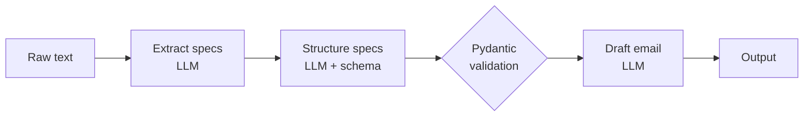

# 01 · Prompt Chaining

## Summary

Prompt chaining (also called the Pipeline pattern) splits one complex request into a sequence of small, focused LLM calls, where the output of each step becomes the input of the next. Each step has one job and its own prompt, and possibly its own role ("market analyst", then "technical writer"). Ordinary code can sit between steps to validate, transform, branch, or call tools. It is the base pattern almost every other agentic pattern builds on.

## Problem and when to use it

A single prompt that asks for several things at once ("summarize this report, extract trends with data, then draft an email") overloads the model. Typical failures: parts of the instruction get ignored, the model loses the original context, an early mistake spreads through the rest of the answer, and hallucination goes up.

**Use it when**
- The task has distinct stages (extract, then transform, then write).
- You need deterministic checks or tool calls between stages.
- You want to debug or tune each stage separately.

**Avoid it when**
- One prompt already does the job reliably. Every extra step adds latency, cost, and another place to fail.
- The sub-tasks are independent of each other. Run them in parallel instead (see [Parallelization](../03-parallelization/README.md)).
- The next step depends on the input type. That calls for [Routing](../02-routing/README.md).

## Key takeaways

- Break one hard prompt into a chain of easy prompts. Step N's output is step N+1's input.
- A narrower prompt lowers the model's cognitive load, which gives more accurate and controllable output.
- The chain is only as reliable as the data passed between steps, so use structured output (JSON or a schema) at the boundaries.
- Plain code between LLM calls (validation, normalization, a calculator tool, retries) is a feature of the pattern, not a workaround.
- Complex workflows mix the two shapes: parallel steps for independent gathering, then a sequential chain for the dependent synthesis and review steps.
- Context engineering, not prompt wording, is the real lever. Decide what each step gets to see: system prompt, retrieved documents, tool outputs, and implicit state such as user identity and history.

## Non-obvious details

- **Structured handoffs.** Free text between steps is the main source of chain failures. If step 2 returns `{"trends": [{"trend_name": ..., "supporting_data": ...}]}`, step 3 can parse it exactly. With LangChain, `with_structured_output(PydanticModel)` makes the schema a hard contract.
- **Error propagation.** A wrong early step poisons every later step. Validate at the boundaries. For example, in invoice extraction, check that the required fields exist and are well formed, and if not, re-prompt only for the missing fields.
- **Delegate what LLMs do badly.** Arithmetic and exact lookups belong in a tool or in plain code placed between steps, not in a prompt.
- **One role per step.** A different persona or system prompt per step is cheap and noticeably improves focus.
- **Conversation as a chain.** Each user turn can be a small chain: extract intent and entities, update state, then respond from that state. This is the simplest form of stateful conversation.
- **LCEL vs LangGraph.** LangChain's `|` (LCEL) covers linear chains. Once you need loops or shared mutable state, move to LangGraph.



## Worked example

[`chain.py`](chain.py) builds a three-step LCEL pipeline:

1. `extract_specs` pulls the specifications out of free text and returns a string.
2. `structure_specs` maps them onto the `LaptopSpecs` Pydantic schema using `with_structured_output`. A malformed answer fails here instead of later in the chain.
3. A lambda turns the model into a dict, and `draft_email` writes an announcement from those exact fields.

The dict literal `{"specifications": extract_specs}` is LCEL shorthand for "run this runnable and put its result under this key", which is how one step's output is wired into the next prompt's variable.

Between steps, `steps.step("name")` taps from the shared [`step_logger.py`](../step_logger.py) print each intermediate value in a bordered panel and pass it through unchanged. `phase(...)` draws a rule at each stage boundary, so the run reads as input, extract, structure, draft.

```bash
pip install -r ../requirements.txt
export GOOGLE_API_KEY=...
PYTHONPATH=.. python chain.py
```

From the repo root, `make run CH=01` does the same.
