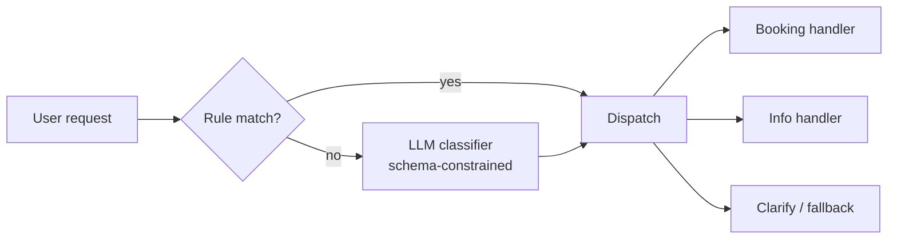

# 02 · Routing

## Summary

Routing adds conditional control flow to an agent. A router first examines the input (or the current state) and then sends it to one of several specialized paths: a sub-agent, a tool, a chain, or an escalation path. The router can be an LLM, embedding similarity, hand-written rules, or a small trained classifier. Routing turns a fixed pipeline into a system that chooses its next step.

## Problem and when to use it

A linear chain treats every input the same. Real traffic is mixed: order-status questions, product questions, bug reports, and nonsense all arrive through one door. Without a decision point you either build one giant prompt that handles everything badly, or you can't handle the variety at all.

**Use it when**
- Inputs fall into distinct categories that need different handling (triage, intent detection, file-format dispatch).
- A coordinator must choose between specialist agents or tools.
- A step in a pipeline must branch based on the previous result.

**Avoid it when**
- All inputs follow the same path. A router then only adds latency and a new way to fail.
- The categories overlap so much that the router guesses at random. Merge the routes or improve the category definitions first.

## Key takeaways

- A router is a classifier plus a dispatch table. Keep the two parts separate.
- There are four ways to implement the router. **LLM** routing is flexible but slower, costs money, and is non-deterministic. **Embedding** routing matches on meaning, using vector similarity to route descriptions. **Rules** are fast and deterministic but brittle. A **trained classifier** puts the routing logic in fine-tuned weights, with no LLM call at inference time.
- Routing can happen at several points: at the entry (task classification), in the middle of a chain (what to do next), or inside a step (which tool to use).
- Always include a fallback route ("unclear", which leads to clarification or a human). The model will produce labels you didn't plan for.
- LangGraph makes routes explicit as conditional edges between nodes. ADK makes them implicit: the LLM delegates to `sub_agents` based on their `description` (called Auto-Flow).

## Non-obvious details

- **Constrain the router's output.** The book's example asks for "ONLY one word" and then calls `.strip()` on the result. That works, but a schema (`Literal["booking","info","unclear"]` via structured output) removes the parsing problem completely.
- **Put cheap rules first.** A keyword or regex check that settles the obvious cases skips an LLM call. Send only the ambiguous cases to the model. This hybrid is usually the best trade-off between cost and accuracy.
- **In ADK, descriptions are the routing table.** The coordinator chooses a sub-agent by reading each sub-agent's `description`. Vague descriptions cause misrouting. Tool docstrings work the same way and are sent to the model.
- **Routing depends on state, not only on input.** In LangGraph the router function reads the accumulated graph state, so it can route on "how many retries so far" or "did the tool fail", not only on what the user said.
- **Failure mode: silent misroute.** A wrong route still produces a confident answer from the wrong specialist. Log every routing decision so you can audit it.



## Worked example

- [`router.py`](router.py) (LangChain) uses a hybrid router. `route_by_rule` catches obvious booking keywords. Everything else goes to an LLM classifier whose output is forced into the `RouteDecision` schema. `HANDLERS` is the dispatch table, and `"unclear"` is the fallback. The `assert` lines check the rule layer without an API key.
- [`router_adk.py`](router_adk.py) (Google ADK) shows LLM-driven delegation. `Coordinator` has two `sub_agents`, and ADK transfers control to whichever sub-agent's description fits the request. No routing code is written by hand. The docstrings on `book` and `lookup` are kept on purpose because ADK sends them to the model as tool descriptions.

```bash
pip install -r ../requirements.txt
export GOOGLE_API_KEY=...
python router.py
python router_adk.py
```
