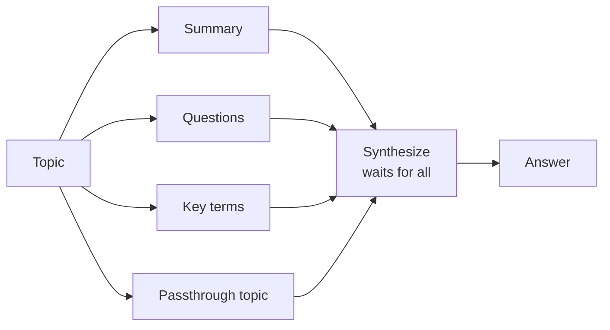

# 03 · Parallelization

## Summary

Parallelization runs independent steps (LLM calls, tool calls, or whole sub-agents) at the same time instead of one after another, then joins their results in a final step. The workflow becomes fan-out, then fan-in: several branches start from a common input, and a sequential aggregator merges what they produce. Total latency drops from the sum of all branches to roughly the slowest branch.

## Problem and when to use it

Sequential workflows waste time when steps don't depend on each other. This hurts most when each step waits on I/O such as an LLM API, a search engine, or a database. Five 2-second lookups take 10 seconds in sequence and about 2 seconds in parallel.

**Use it when**
- Gathering from several sources (news, stock data, internal DB) for one report.
- Running several analyses over the same input (sentiment, keywords, urgency).
- Making several independent validations or tool calls (flight prices, hotels, events).
- Generating several variants to pick the best one (A/B headlines).

**Avoid it when**
- Step B needs step A's output. That is a chain, not parallel work.
- Rate limits or cost caps are tight. Parallel branches spend tokens and quota at the same moment.
- The extra debugging and logging complexity outweighs the time saved on a fast workflow.

## Key takeaways

- Find the parts of the workflow with no data dependency on each other and run them at the same time.
- The shape is almost always fan-out, then a sequential synthesis step. The join step waits for every branch.
- LangChain: `RunnableParallel` (or a plain dict in LCEL) runs its branches concurrently. Use `ainvoke` to get real async concurrency.
- ADK: `ParallelAgent` runs its sub-agents concurrently. Wrap it in a `SequentialAgent` followed by a merger agent.
- Concurrency adds real complexity and cost to design, debugging, and logging. Use it where latency matters.

## Non-obvious details

- **Concurrency is not parallelism.** `asyncio` interleaves waiting tasks on one thread under the GIL. That is enough here because LLM and API calls are I/O-bound, but CPU-heavy branches would need processes.
- **State is how branches hand off.** In ADK, each parallel sub-agent writes its result to session state via `output_key`. The merger reads those values through `{key}` placeholders in its instruction. Use distinct keys, or branches will overwrite each other.
- **Ground the aggregator.** The book's merger is told to use ONLY the provided summaries. Without that rule, the synthesis step adds facts from the model's own knowledge, and you can no longer tell where a claim came from.
- **Pass the original input through.** `RunnablePassthrough()` inside the parallel block keeps the original topic available to the synthesis prompt next to the branch outputs.
- **Branch failure policy.** Decide in advance what happens if one branch fails or is slow: fail the whole job, continue with partial results, or time out. Frameworks mostly leave this to you.
- **Mixed shapes are normal.** Real pipelines interleave patterns: parallel extraction per document, then a sequential chain of collate, draft, and review.



## Worked example

- [`parallel.py`](parallel.py) (LangChain) defines three branches (`summary`, `questions`, `key_terms`) plus a passthrough inside `RunnableParallel`, then pipes the joined dict into one synthesis prompt. `ainvoke` runs the branches concurrently.
- [`parallel_adk.py`](parallel_adk.py) (Google ADK) runs three researcher `LlmAgent`s inside a `ParallelAgent`. Each writes to its own `output_key`. A `SequentialAgent` then runs the `Synthesizer`, whose instruction pulls in `{renewables}`, `{evs}`, and `{carbon_capture}` from state. The book's version also gives each researcher the `google_search` tool. It is left out here to keep the example minimal.

```bash
pip install -r ../requirements.txt
export GOOGLE_API_KEY=...
python parallel.py
python parallel_adk.py
```
