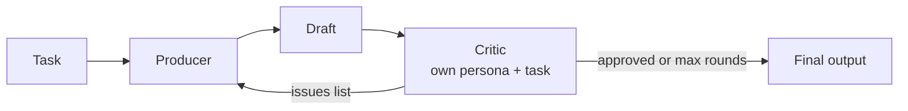

# 04 · Reflection

## Summary

Reflection adds a feedback loop. The agent produces an output, evaluates it against explicit criteria, and uses that critique to produce a better version. The loop repeats until the output passes or a round limit is hit. The strongest form splits the work into two roles: a **Producer** that generates and a **Critic** with its own persona and instructions that only looks for flaws. Chaining passes output forward. Reflection sends it back.

## Problem and when to use it

The first draft from an LLM is often wrong in small ways: a missed edge case, an unsupported claim, an ignored constraint. A plain pipeline ships that first draft no matter how good it is.

**Use it when**
- Quality and correctness matter more than latency and cost: code, long-form writing, plans, summaries that must be complete.
- There are clear criteria to check against (requirements, tests, facts, a style guide).
- An objective or specialist review would catch what a generalist producer misses. That is when to use a separate critic.

**Avoid it when**
- The work is time-sensitive. Each round adds at least two LLM calls.
- There are no real criteria. A critic without a standard just reshuffles style.
- A deterministic check exists (compiler, unit tests, schema validator). Use it as the critic, or at least alongside the LLM critic.

## Key takeaways

- The loop is execute, evaluate, refine, then repeat until a stop condition.
- Producer and critic should be separate calls with separate system prompts. A model reviewing its own output in the same context tends to approve it.
- Every loop needs two exits: "approved" and "max iterations reached".
- Costs are real: more latency, more tokens, a growing context, and a higher chance of rate limiting.
- Reflection gets stronger when combined with Goal Setting (the goal is the benchmark, see Ch 11) and Memory (past critiques prevent repeated mistakes, see Ch 8).

## Non-obvious details

- **Structured verdicts.** The book's critic signals success by including the phrase `CODE_IS_PERFECT`. String matching on free text is fragile. A schema such as `{approved: bool, issues: [...]}` makes the stop condition reliable and gives the producer an actionable list.
- **Give the critic the original task.** The critic must judge the output against the requirements, not in isolation. Otherwise it reviews whatever the producer chose to do.
- **Context grows.** The producer's history accumulates task, draft, critique, draft, and so on. Cap the number of rounds, or summarize old rounds, or you will hit context limits and rising costs.
- **ADK loop mechanics.** `LoopAgent` repeats its sub-agents until `max_iterations` or until a sub-agent escalates. The built-in `exit_loop` tool sets `escalate=True`, so the critic ends the loop by calling a tool. State keys (`output_key`) carry the draft and critique between agents.
- **Sequential vs loop in ADK.** The book's main ADK example is a `SequentialAgent` (generate, then review once). That is single-pass reflection. True iteration needs `LoopAgent`.
- **Failure mode: oscillation.** Producer and critic can disagree forever, or the critic keeps inventing nitpicks. The iteration cap is a required safety net, not an optimization.



## Worked example

- [`reflection.py`](reflection.py) (LangChain) asks the producer for a factorial function. The critic returns a `Critique` object (`approved`, `issues`). If it isn't approved, the issues are appended to the producer's history as a revision request. The loop stops on approval or after `MAX_ROUNDS`.
- [`reflection_adk.py`](reflection_adk.py) (Google ADK) runs a `LoopAgent` with `Writer` and `FactChecker`. The writer reads `{critique?}`. The `?` makes the placeholder optional, so the first round works before any critique exists. The fact-checker either lists errors (saved to `critique`) or calls `exit_loop`.

```bash
pip install -r ../requirements.txt
export GOOGLE_API_KEY=...
python reflection.py
python reflection_adk.py
```
