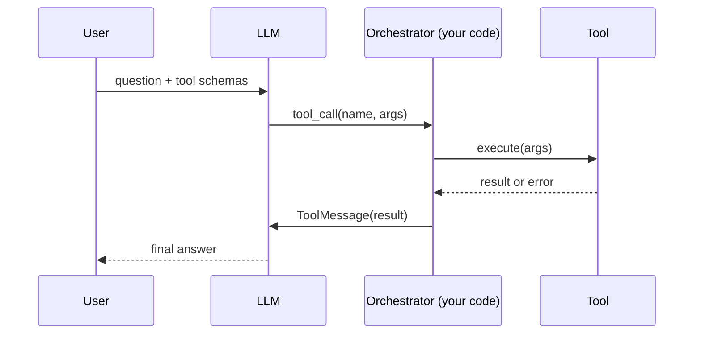

# 05 · Tool Use (Function Calling)

## Summary

Tool use lets the LLM act outside its own weights. You describe the available functions (name, purpose, typed parameters). The model decides whether a call is needed and emits a structured call (`{"name": ..., "args": {...}}`). The orchestration layer runs the real function and feeds the result back. The model then answers, or calls another tool. A "tool" can be a Python function, a REST API, a database query, a code interpreter, or another agent.

## Problem and when to use it

An LLM's knowledge is frozen at training time. It can't see private data, can't do exact arithmetic reliably, and can't change anything in the world.

**Use it when** the agent needs any of these:
- Real-time data (weather, prices, news).
- Private or proprietary data (company DB, a user's orders).
- Precise computation or code execution.
- Actions with side effects (send email, update a record, toggle a device).

**Avoid it when**
- The answer is stable general knowledge. A tool call adds latency and another failure point.
- Calls are fixed and always happen. Call the function yourself in code (a chain), and don't make the model decide.

## Key takeaways

- The loop: define tools, the LLM decides, the LLM emits a structured call, the framework executes it, the result goes back to the LLM, then the LLM answers or calls again.
- **The model never executes anything.** It only proposes a call. Your code runs it, so your code owns validation, permissions, and errors.
- The tool's name, docstring, and parameter types are the model's only documentation. Write them like an API contract.
- Return errors to the model as observations instead of crashing. The model can then retry, ask the user, or explain the failure.
- Frameworks hide the loop: LangChain (`@tool`, `bind_tools`, agent executors), CrewAI (`@tool` on an Agent and Task), ADK (plain functions plus built-ins such as Google Search, code execution, and Vertex AI Search).

## Non-obvious details

- **Function calling vs extensions.** With function calling, the client executes the call. With Vertex AI Extensions, the platform executes it automatically, with enterprise controls. That is the key difference the book draws.
- **Built-in code execution.** ADK's code executor gives the model a sandboxed interpreter. Use it for math and data work, which LLMs get wrong when they do it "in their head". The event stream then contains the generated code and its result alongside the final answer.
- **Grounding tools.** Google Search and Vertex AI Search tools turn tool use into retrieval (see Ch 14). The model answers from fresh or private documents instead of from memory.
- **Bound the loop.** A model can call tools forever (retrying a failing call, ping-ponging between tools). Always cap the number of steps.
- **Parallel tool calls.** Modern models can emit several calls in one turn (`reply.tool_calls` is a list). Execute all of them and return one `ToolMessage` per call, matched by `tool_call_id`.
- **Tools that call agents.** Treating a specialist agent as a tool is the bridge to multi-agent systems (Ch 7).
- **Security.** Tool arguments come from the model, which is influenced by user input. Validate them as untrusted input, especially for tools with side effects (see Ch 18).



## Worked example

- [`tool_loop.py`](tool_loop.py) is the raw function-calling loop with no agent framework, so every step is visible. `bind_tools` sends the schemas for `get_stock_price` and `multiply`. `ask()` loops: invoke the model, stop if there are no `tool_calls`, otherwise run each call through `run_tool` and append the results as `ToolMessage`s. Unknown tickers come back as `"ERROR: ..."` text instead of an exception, so the model can explain the failure. `MAX_STEPS` bounds the loop. The `assert` lines check tool execution offline.
- [`tool_adk.py`](tool_adk.py) is the same idea in ADK: a plain Python function becomes a tool. ADK builds the schema from the type hints and docstring. The tool returns a `{"status": ...}` dict so success and failure are explicit. `verbose=True` prints each tool call and result.

```bash
pip install -r ../requirements.txt
export GOOGLE_API_KEY=...
python tool_loop.py
python tool_adk.py
```
