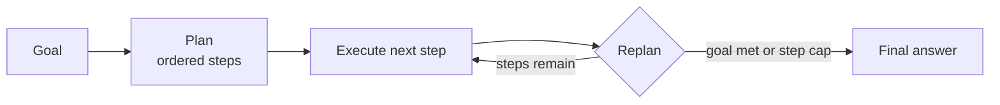

# 06 · Planning

## Summary

Planning means the agent works out *how* to reach a goal before acting. Given only the *what* (the goal and its constraints), the agent breaks it into an ordered list of executable steps, carries them out, and revises the plan when results or new constraints call for it. The plan is generated at runtime and treated as a starting point, not a script. Deep-research agents (Gemini Deep Research, OpenAI's Deep Research API) are the flagship example: they draft a research plan, run an iterative search-and-analyze loop that fills knowledge gaps, then synthesize a cited report.

## Problem and when to use it

Multi-step goals with dependencies ("organize a team offsite", "write a competitive analysis") can't be met with one action. A purely reactive agent loses track of where it is and stops early.

**Use it when**
- The *how* has to be discovered: the steps depend on the specific request or on what earlier steps reveal.
- The task needs a sequence of interdependent operations: research reports, onboarding workflows, multi-step troubleshooting.

**Avoid it when**
- The *how* is already known and repeatable. A fixed workflow (a chain, Ch 1) is more predictable, cheaper, and easier to test. The author is explicit: dynamic planning trades predictability for flexibility, so use it only when you need that flexibility.

## Key takeaways

- The deciding question: does the *how* need to be discovered, or is it already known?
- A planner turns a goal into discrete steps. An executor runs them. A re-planner updates the plan from the results.
- Adaptability is the point. When a venue is booked or a source is missing, re-plan instead of failing.
- You can encourage planning just by asking for it ("first write a bullet plan, then do it"). That is how the book's CrewAI example works.
- Deep research systems combine planning with tool use (search), reflection (gap detection), and long-running async execution.

## Non-obvious details

- **Let a human review the plan.** Gemini Deep Research shows its plan to the user for editing *before* it executes. This is cheap human-in-the-loop (Ch 13) at the point where a correction costs least.
- **Long-running and async.** Real research agents run for minutes and touch hundreds of sources. They are built to survive single failures and notify the user when done, not to block a request.
- **Transparency.** The OpenAI Deep Research API exposes the intermediate steps: reasoning summaries, the exact search queries, and code it ran, plus inline citations with character offsets. Planning agents are much easier to debug when the plan and each step are inspectable.
- **Plan-and-execute vs ReAct.** Plan-and-execute commits to a step list up front, then replans. ReAct (Ch 17) decides one step at a time. Up-front plans are easier to review and cheaper for the executor. ReAct reacts faster to surprises.
- **Bound the replanning.** A replanner can keep adding steps forever. Cap the total number of steps and force a final answer.
- **Failure mode: plausible but wrong plans.** LLM plans read well even when a step is impossible with the tools available. Give the planner the list of tools and constraints it is planning against.



## Worked example

[`plan_execute.py`](plan_execute.py) is a LangGraph plan-and-execute loop:

- `plan` asks for 2–4 steps through the structured `Plan` schema.
- `execute` pops the first step, runs it with the goal and prior results as context, and appends `(step, result)` to `completed`. The `operator.add` reducer makes this list append-only.
- `replan` returns a `Replan` verdict: done with a `final_answer`, or a possibly revised list of remaining steps. `MAX_STEPS` forces termination.
- The conditional edge `replan -> execute | END` is the loop.

The book's own example is a single CrewAI agent prompted to "plan, then write". The graph version makes the plan explicit, inspectable state.

```bash
pip install -r ../requirements.txt
export GOOGLE_API_KEY=...
python plan_execute.py
```
