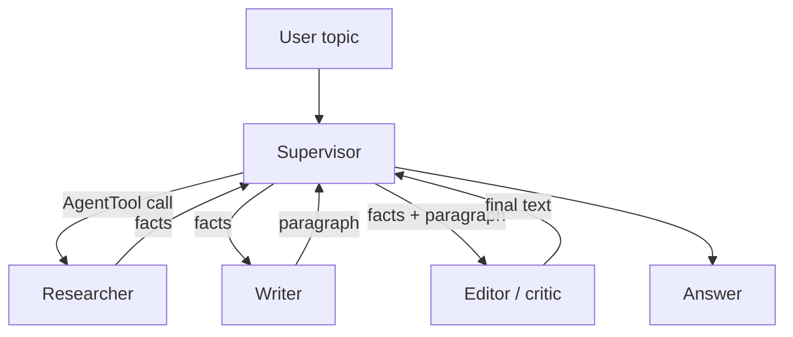

# 07 · Multi-Agent Collaboration

## Summary

Multi-agent collaboration splits a system into several specialized agents. Each has its own role, instructions, tools, and data access, and they coordinate toward one goal. A research query, for example, might go to a Research agent, a Data Analysis agent, and a Synthesis agent. The value comes from two things: dividing the labour, and having clear communication between agents (a shared protocol and shared vocabulary). It is the multi-agent version of the earlier patterns: chaining becomes sequential handoffs, parallelization becomes parallel agents, and reflection becomes critic agents.

## Problem and when to use it

A single agent with every tool and every instruction becomes a bottleneck. The prompt bloats, tool choice gets worse, and one model has to be good at everything.

**Use it when**
- The task decomposes into sub-tasks that need different skills, tools, or data (research, then write, then edit; code, then test, then document).
- You want a separate critic for quality, policy, or security review.
- Parts can run in parallel, or need corroboration across sources.

**Avoid it when**
- One agent with a few tools does the job. Every extra agent adds latency, tokens, and coordination bugs.
- The sub-tasks share so much context that passing it between agents costs more than the specialization saves.

## Key takeaways

- **Collaboration forms:** sequential handoffs, parallel processing, debate and consensus, hierarchical manager and workers, expert teams, critic-reviewer.
- **Communication topologies:** single agent, network (peer-to-peer), supervisor, supervisor-as-tool, hierarchical (layers of supervisors), custom/hybrid.
- Picking the topology is the main design decision. It trades control against resilience and communication overhead.
- A multi-agent system is defined by three things: roles, communication channels, and the task flow/protocol.
- ADK building blocks: `sub_agents` (LLM-driven transfer), `SequentialAgent`, `ParallelAgent`, `LoopAgent`, custom `BaseAgent`, and `AgentTool` (agent-as-tool).

## Non-obvious details

- **Supervisor trade-off.** A supervisor gives clear authority and simple control, but it is a single point of failure and becomes a bottleneck as the number of workers grows. A network topology is more resilient, but it is harder to keep coherent and talks more.
- **Transfer vs agent-as-tool.** With `sub_agents`, the parent *hands over* the conversation and the child responds to the user. With `AgentTool`, the parent *calls* the child like a function, gets the result back, and stays in control. That lets it chain several specialists and post-process their output. Choose based on who should own the final answer.
- **Non-LLM agents.** A custom `BaseAgent` subclass can be deterministic code (a status checker, a task executor) that still takes part in the hierarchy. The book's `ConditionChecker` stops a `LoopAgent` by yielding an event with `EventActions(escalate=True)`.
- **State is the shared blackboard.** ADK workflow agents pass data through session state via `output_key` and `{placeholders}`. Distinct keys prevent agents from overwriting each other.
- **Descriptions route work.** Whether through transfer or `AgentTool`, the parent picks a specialist from its `description`. Treat descriptions as interface contracts.
- **Robustness is earned, not automatic.** The book claims one agent's failure needn't sink the system, but that only holds if the orchestrator handles worker errors (see Ch 12).
- **Separate actions from reasoning.** The book's image example gives the low-level action (`generate_image`) to a specialist agent as a function tool. The higher-level agent only reasons and delegates.



## Worked example

[`team_adk.py`](team_adk.py) is a supervisor-as-hub team. `Supervisor` holds three specialists wrapped in `AgentTool`: `Researcher` (facts), `Writer` (paragraph), and `Editor` (a critic that checks the paragraph against the facts). Because they are tools and not `sub_agents`, the supervisor keeps control. It sequences the calls, passes outputs between specialists, and returns the final text. `verbose=True` shows each delegation.

For the other ADK coordination primitives, see [Routing](../02-routing/README.md) (`sub_agents` transfer), [Parallelization](../03-parallelization/README.md) (`ParallelAgent` + `SequentialAgent`), and [Reflection](../04-reflection/README.md) (`LoopAgent`).

```bash
pip install -r ../requirements.txt
export GOOGLE_API_KEY=...
python team_adk.py
```
