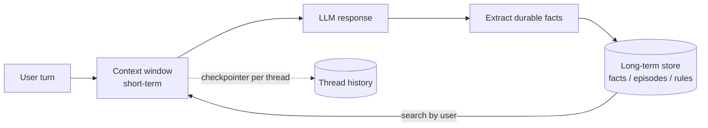

# 08 · Memory Management

## Summary

Memory lets an agent use information from earlier turns, earlier sessions, and its own experience. There are two tiers. **Short-term (contextual) memory** is whatever sits in the context window for the current interaction: recent messages, tool results, reflections. It is limited in size and disappears when the session ends. **Long-term (persistent) memory** lives outside the model, in a database, knowledge graph, or vector store. The agent searches it and loads relevant pieces back into the short-term context when needed.

## Problem and when to use it

Without memory, an agent is stateless. It forgets the user's name between turns, can't track progress on a multi-step task, and can't personalize or learn.

**Use it when**
- Conversations span multiple turns: short-term memory.
- Users come back and expect continuity (preferences, past issues): long-term memory.
- Multi-step tasks need progress tracking: session state.
- The agent should improve from past successes and failures (see Ch 9).

**Avoid it when**
- Interactions are genuinely one-shot. Persisting user data then adds privacy risk and storage for nothing.
- You are tempted to stuff entire histories into a long context window. A large window is still short-term memory: it is ephemeral, costly to reprocess every turn, and lowers answer quality as it fills.

## Key takeaways

- Short-term memory is the context window. Long-term memory is external storage plus retrieval (often semantic search).
- **ADK model:** `Session` (one chat thread with its events), `State` (that thread's key-value scratchpad), `MemoryService` (searchable knowledge across sessions). `SessionService` manages session lifecycles, with in-memory, database, and Vertex AI backends.
- **ADK state prefixes set scope:** no prefix means this session only, `user:` means all of this user's sessions, `app:` means all users, and `temp:` means the current turn only and is never persisted.
- **LangGraph model:** a *checkpointer* holds thread-scoped short-term memory (resumable by `thread_id`). A *store* holds cross-thread long-term memory as JSON documents under a namespace and key.
- **Long-term memory types:** *semantic* (facts and preferences, kept as a profile or a collection), *episodic* (past experiences, often reused as few-shot examples), *procedural* (rules and instructions, which the agent can rewrite through reflection).

## Non-obvious details

- **Never mutate `session.state` directly in ADK.** Such changes skip the event log, may not persist, cause concurrency problems, and don't update timestamps. Write state only through `output_key` (for the agent's final text) or `EventActions(state_delta=...)` on an appended event. A tool can do this via `tool_context.state`.
- **Keep state simple:** serializable basic types, clear key names, correct prefixes, shallow nesting.
- **Profile vs collection.** One JSON profile per user is easy to read, but every update must merge into it. A collection of small fact documents is easy to append to, but grows and can contradict itself. Managed services such as Vertex AI Memory Bank extract facts asynchronously with an LLM and *consolidate* them, resolving contradictions.
- **Procedural memory via reflection.** An agent can be shown its current instructions plus recent interactions and asked to rewrite those instructions, then store them back. This is a self-modifying system prompt, so add guardrails around it.
- **Memory extraction is its own step.** Deciding *what* is worth remembering is a separate LLM call (or a background job). Saving every message raw clutters later retrieval.
- **Legacy LangChain memory.** The book shows `ConversationBufferMemory` and `LLMChain`. These are legacy APIs. Current LangChain/LangGraph uses checkpointers for history and stores for long-term memory, as in the example below.



## Worked example

- [`memory_langgraph.py`](memory_langgraph.py) shows both tiers in LangGraph. The `InMemorySaver` checkpointer keeps each `thread_id`'s messages, so "What's my name?" works inside thread `t1`. After each reply, the `remember` node extracts durable facts with a schema and writes them to an `InMemoryStore` under `("facts", user_id)`. In a *new* thread `t2`, `respond` loads those facts into the system prompt, so the vegetarian preference carries across conversations.
- [`state_scopes_adk.py`](state_scopes_adk.py) runs **offline, with no API key**. It demonstrates ADK state scopes using `InMemorySessionService`. Two sessions for the same user each append an event with a `state_delta`. `user:login_count` is shared and reaches 2, while `temp:validation_needed` is never persisted. The asserts check both.

```bash
pip install -r ../requirements.txt
python state_scopes_adk.py
export GOOGLE_API_KEY=...
python memory_langgraph.py
```
