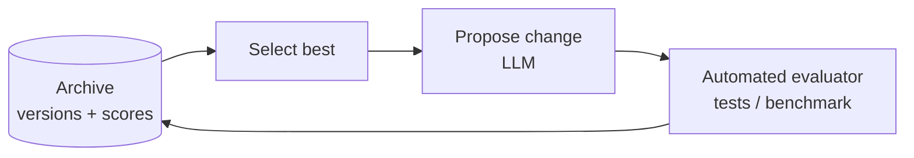

# 09 · Learning and Adaptation

## Summary

Learning and adaptation let an agent change its knowledge, strategy, or even its own code based on experience, so it improves without being reprogrammed by hand. Mechanisms range from classic ML (reinforcement, supervised, unsupervised, online learning) to LLM-native methods (few-shot prompting, memory-based learning) to systems that modify themselves. The book's case studies all share one loop: **propose a change, measure it with an automated evaluator, keep the best, repeat.** SICA (an agent that edits its own codebase), AlphaEvolve, and OpenEvolve (LLM plus evolutionary search over programs) are the examples.

## Problem and when to use it

Fixed logic decays in environments that change: new fraud patterns, shifting user preferences, new kinds of tasks. A static agent can't personalize or improve with use.

**Use it when**
- The environment is dynamic or uncertain, and you can measure success.
- Personalization or continuous improvement is a product requirement.
- There is an objective evaluator (benchmarks, tests, labeled examples, a reward signal) to tell better from worse.

**Avoid it when**
- You can't evaluate changes automatically. "Learning" without a score is drift.
- The behaviour must stay auditable and fixed (regulated decisions). Self-modification then needs heavy gating, or shouldn't happen.

## Key takeaways

- *Adaptation* is the visible change in behaviour. *Learning* is what produces it.
- **PPO** improves a policy with small, *clipped* updates inside a trust region, so training doesn't collapse. **DPO** aligns LLMs directly on preference pairs, skipping the separate reward model (and the reward hacking that comes with it).
- **SICA** keeps an archive of past versions and their benchmark scores. It picks the best by a weighted score (success, time, cost), lets it edit its own code, re-benchmarks, and repeats. It invented its own tools along the way (a smart diff editor, an AST symbol locator).
- **AlphaEvolve** uses Gemini Flash for many cheap proposals, Gemini Pro for deeper refinement, automated scoring, and evolutionary selection. Results include a 0.7% reduction in Google's fleet-wide compute, a 23% faster Gemini kernel, and a 4×4 complex matrix multiplication with 48 scalar multiplications.
- Memory (Ch 8) and RAG (Ch 14) are the cheapest form of learning: store solved problems and successful strategies, then retrieve them next time.

## Non-obvious details

- **The evaluator is the whole game.** Every self-improving system in the chapter depends on an automated, trustworthy score. A weak evaluator gets gamed, as with the reward hacking DPO avoids.
- **Overseer agent.** SICA runs an asynchronous LLM overseer next to the main agent. It reads a callgraph and an event log, detects loops and stagnation, and can cancel execution. Long autonomous runs need such a watchdog.
- **Sub-agents manage context.** SICA calls coding, problem-solving, and reasoning sub-agents like tools, partly to keep the main context window from overflowing during long improvement cycles.
- **Structured context window.** SICA arranges its context into a system prompt (goals, tool docs), a core prompt (problem, open files, directory map), and assistant messages (reasoning, tool results, overseer notes). File changes are kept as diffs and consolidated periodically.
- **Sandbox self-modification.** An agent that can run shell commands and edit its own code must run in isolation. SICA uses Docker containers, plus an observability UI over its event bus.
- **Open problem.** Getting an LLM to propose *novel*, feasible modifications, not just incremental ones, is still unsolved.
- **Multi-agent tuning data.** To improve a multi-agent system, training data must capture the whole interaction trajectory, including each agent's inputs and outputs.



## Worked example

[`self_improve.py`](self_improve.py) runs the SICA/AlphaEvolve loop on a safe target: a prompt instead of executable code. This is procedural memory being learned.

- `evaluate()` scores a candidate instruction against `LABELED_TICKETS` (exact-match accuracy) and returns the failures.
- `propose()` asks a high-temperature model to rewrite the best instruction, given its failures.
- `evolve()` keeps an `archive` of `(score, instruction, failures)`. Each generation it selects the best entry, proposes a variant, evaluates it, and appends it. It stops on a perfect score or after `GENERATIONS`.

Prompts are evolved rather than code so the example never executes model-written programs. Evolving code would need a sandbox, as SICA uses.

```bash
pip install -r ../requirements.txt
export GOOGLE_API_KEY=...
python self_improve.py
```
