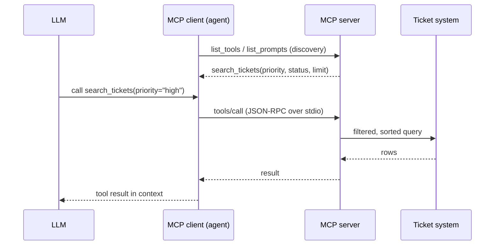

# 10 · Model Context Protocol (MCP)

## Summary

MCP is an open client-server standard for connecting LLM applications to external capabilities. You can think of it as a universal adapter between any model and any system. An **MCP server** exposes three kinds of things. **Tools** are executable actions. **Resources** are data you read. **Prompts** are reusable interaction templates. An **MCP client** (the agent or host app) connects to the server, *discovers* what it offers at runtime, and calls it in a standard format. Function calling is a vendor-specific, one-to-one mechanism. MCP is a protocol that makes integrations reusable across models and applications.

## Problem and when to use it

Without a standard, every pairing of an LLM with a tool is a custom integration. N agents and M systems mean N×M bespoke adapters, and nothing is reusable.

**Use it when**
- Many agents or apps should share the same tools and data sources (databases, SaaS APIs, internal services).
- Agents should discover new capabilities without being redeployed.
- You want to wrap legacy services once and compose them in new workflows.

**Avoid it when**
- You have a small, fixed set of functions inside one app. Direct function calling (Ch 5) is simpler.

## Key takeaways

- **Roles:** LLM (decides), MCP client (translates intent into protocol calls), MCP server (gateway that exposes capabilities), and optionally a third-party service (does the real work).
- **Flow:** discovery (list tools, resources, prompts), the LLM picks a tool, the client sends a standard call, the server authenticates, validates, and executes, then the result goes back into the LLM's context.
- **Transports:** JSON-RPC over STDIO for local servers; Streamable HTTP (and the older SSE) for remote servers.
- **Function calling vs MCP:** proprietary vs open, a direct call vs a discovery framework, tightly coupled vs reusable standalone servers.
- **ADK** consumes servers via `McpToolset` (stdio or HTTP, optional `tool_filter`). It can also expose ADK tools *as* an MCP server. FastMCP-style decorators generate schemas from type hints and docstrings.

## Non-obvious details

- **MCP doesn't fix bad APIs.** Wrapping a legacy API as-is gives the agent the same limits. If a ticket API only fetches tickets one at a time, "summarize high-priority tickets" is slow and error-prone. Add deterministic filtering and sorting to the server. The author's line: agents don't replace deterministic workflows; they need *stronger* deterministic support.
- **Data must be agent-readable.** MCP doesn't guarantee the payload is usable. A document server that returns PDFs is nearly useless to an agent that can't parse them. Serve Markdown or text instead.
- **Security is your job.** Authentication and authorization decide which clients can reach which servers and actions. MCP gives you the channel, not the policy. Narrow the tool surface with `tool_filter`.
- **Error contract.** Tool failures, unavailable servers, and invalid requests must come back to the LLM in a form it can reason about, so it can try something else.
- **Local vs remote.** A local stdio server keeps sensitive data on the same machine and avoids network hops. A remote server is shared and scalable across an organization.
- **SDK churn.** The book uses `FastMCP`. In the current MCP Python SDK (v2) the same decorator API is called `MCPServer` (`from mcp.server import MCPServer`).



## Worked example

- [`tickets_server.py`](tickets_server.py) is an MCP server exposing all three primitives. The `search_tickets` tool does server-side **filtering and sorting**, following the author's agent-friendly API rule. There is a `tickets://{ticket_id}` resource that returns readable text, and a `triage_summary` prompt template.
- [`discover.py`](discover.py) runs **offline, with no API key**. A plain MCP client launches the server over stdio, discovers its tools and prompts, and calls `search_tickets` directly. This is the protocol with no LLM involved.
- [`agent_adk.py`](agent_adk.py) is an ADK agent that consumes the same server through `McpToolset` with `tool_filter=["search_tickets"]`. ADK starts the server as a subprocess, discovers the tool, and lets Gemini call it.

```bash
pip install -r ../requirements.txt
python discover.py
export GOOGLE_API_KEY=...
python agent_adk.py
```
