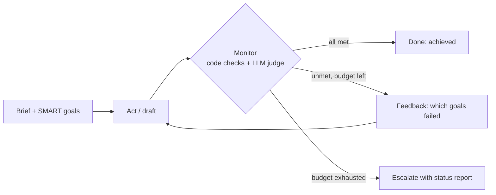

# 11 · Goal Setting and Monitoring

## Summary

Goal setting and monitoring gives an agent an explicit, measurable objective and a mechanism that keeps checking progress against it. The agent acts, a monitor observes the output, its own actions, tool results, and the environment, and the gap between "now" and "goal" drives the next move: continue, revise the plan, or escalate. It is the control loop that turns a reactive agent into an accountable one. Reflection (Ch 4) is often the corrective engine *inside* this loop.

## Problem and when to use it

An agent with only a task description has no idea whether it is succeeding. It stops too early, loops forever, or confidently reports success on work that misses the brief.

**Use it when**
- The agent runs a multi-step task on its own and must reliably reach a specific outcome: resolve a billing issue, hit a milestone date, stay within a risk limit.
- Conditions change and the agent must notice drift and correct course.
- Someone needs to know *whether* the goal was met, not just that the agent stopped.

**Avoid it when**
- The task is one-shot with no success criteria worth checking. The monitoring loop then only adds calls.

## Key takeaways

- Goals should be **SMART**: specific, measurable, achievable, relevant, time-bound. A goal you can't measure can't be monitored.
- Define the metrics and success criteria *before* the run.
- Monitoring covers the agent's actions, the state of the environment, and tool outputs, not only the final text.
- The feedback loop has three exits: goal met, adapt and retry, or **escalate** (a human, or a different strategy).
- In ADK, goals usually live in agent instructions, and monitoring lives in state and tool interactions.

## Non-obvious details

- **LLM self-judgment is weak.** The book's code agent asks the same LLM to write the code *and* judge it ("respond True or False"). The author warns about this directly: the model may misunderstand a goal, hallucinate success, and struggle to see that it is going in the wrong direction.
- **Prefer deterministic monitors.** "You still need to run and test the produced code." Anything that can be measured by code (length, required fields, tests passing, budget used) should be, and the LLM judge kept for genuinely subjective criteria.
- **Separate the roles.** The author's more robust setup is a crew: peer programmer, a *separate* code reviewer, documenter, test writer, and prompt refiner. An independent reviewer and real tests replace self-assessment.
- **Monitoring must bound itself.** The simple example "creates a potential risk of the process running forever". Cap attempts, time, or tokens, and treat hitting the cap as an outcome you report, not a crash.
- **Per-goal verdicts beat one boolean.** Report *which* goals are unmet. That feedback is precise enough for the next attempt to fix, and it makes escalations actionable.
- **Planning vs goals.** Planning (Ch 6) decides the steps. Goal monitoring decides whether those steps are actually getting you there.



## Worked example

[`goal_monitor.py`](goal_monitor.py) writes product copy against four explicit goals:

- Three are **deterministic** checks done in code: word limit, the price `$49`, and the 2-year warranty.
- One is **subjective**: tone, judged by a separate LLM call with a boolean schema.
- `monitor()` returns the *names* of the unmet goals. `pursue()` feeds those back to the writer. It returns `"achieved"` when all goals pass, or `"escalate to human ..."` with the remaining gaps after `MAX_ATTEMPTS`.

The `assert` lines test the deterministic monitors offline.

```bash
pip install -r ../requirements.txt
export GOOGLE_API_KEY=...
python goal_monitor.py
```
