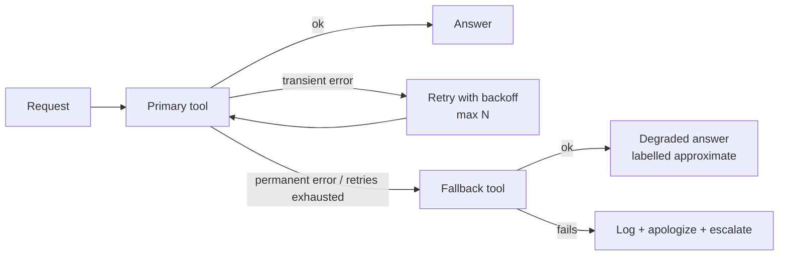

# 12 · Exception Handling and Recovery

## Summary

Agents run against flaky APIs, missing data, slow services, and malformed model output. Exception handling and recovery gives them a planned response to each kind of failure, in three stages. **Detect** the problem (error codes, invalid output, timeouts, nonsense responses). **Handle** it (log, retry, fall back, degrade gracefully, notify). **Recover** to a stable state (roll back, diagnose, self-correct or replan, escalate). The goal is controlled failure instead of a crash or a confident wrong answer.

## Problem and when to use it

Real environments break. A database is down, a trade is rejected, a device doesn't respond, a file is corrupt. An agent with no failure strategy either crashes the whole task or ignores the error and makes something up.

**Use it** in effectively every agent that leaves the demo stage and touches tools, networks, or external data.

**Be careful not to**
- Retry permanent errors ("insufficient funds", 404). That repeats an invalid action and can make things worse.
- Hide failures with silent fallbacks. Degraded results must be labelled as such.

## Key takeaways

- **Detection signals:** malformed tool output, HTTP 404/500, unusually long latency, output that breaks the expected format, and monitoring by other agents for early anomaly detection.
- **Handling toolbox:** logging, retries (for transient errors, possibly with adjusted parameters), fallbacks (an alternative method or model), graceful degradation (partial value), notification (a human or another agent).
- **Recovery toolbox:** state rollback, root-cause diagnosis, self-correction or replanning, escalation.
- Combine with Reflection (Ch 4): analyze *why* an attempt failed, then retry with a better prompt or plan.
- In ADK, a `SequentialAgent` of primary handler, fallback handler, and responder, linked by state flags, gives a guaranteed order of attempts.

## Non-obvious details

- **Classify before you react.** Transient errors (timeout, 503) deserve retries with backoff. Permanent errors (not found, invalid input, business-rule violations) deserve a fallback or escalation, never a retry loop.
- **Keep going on batches.** A document-processing agent should skip the corrupted file, log it, finish the rest, and report what it skipped at the end, not halt everything.
- **Fallback at every layer.** Tools (precise lookup falls back to an approximate one), models (primary model falls back to a backup), and agents (a specialist fails, so a generalist or human takes over).
- **State flags make failure visible.** In the book's ADK example, the primary tool records `primary_location_failed` in state, and the fallback agent reads it. Failures become data that later agents can reason about, not exceptions that vanish.
- **Final safety net.** The response step must handle "nothing worked": apologize, explain, and escalate. It must never fabricate a result from empty state.
- **Errors as observations.** For tools the LLM calls, return a structured error (`{"status": "error", ...}`) so the model can choose its next move (see Ch 5).



## Worked example

- [`recovery.py`](recovery.py) (LangChain) uses the framework's own resilience primitives. `precise_location` simulates two geocoder timeouts (`TransientError`) and a `NotFoundError` for unknown addresses. `.with_retry(retry_if_exception_type=(TransientError,), stop_after_attempt=3)` retries only transient errors. `.with_fallbacks([general_area])` degrades to a city-level answer. The LLM itself is wrapped with a model fallback (Pro, then Flash). A final `except` logs the failure and escalates. The `assert` lines exercise both retry and fallback **offline**, with no API key needed.
- [`recovery_adk.py`](recovery_adk.py) (Google ADK) is the book's structure: a `SequentialAgent` of `PrimaryHandler`, `FallbackHandler`, and `ResponseAgent`. The primary tool always fails here, to force the fallback path. It sets `primary_location_failed` in `tool_context.state`. The fallback agent reads `{primary_location_failed?}` and stores `location_result`, and the responder presents it or apologizes.

```bash
pip install -r ../requirements.txt
export GOOGLE_API_KEY=...
python recovery.py
python recovery_adk.py
```
