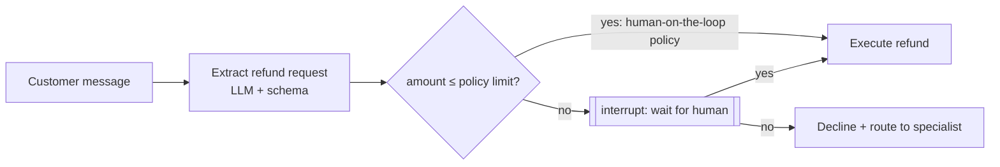

# 13 · Human-in-the-Loop (HITL)

## Summary

Human-in-the-loop puts human judgment at specific points in an agent workflow. The agent does the high-volume, routine work. A human validates, corrects, decides, or takes over where errors are costly, the situation is ambiguous, or ethics are involved. A variant, **human-on-the-loop**, has the human set the *policy* in advance ("auto-sell any stock that drops 10%", "route outage calls to tech support"). The agent then carries that policy out in real time without asking each time.

## Problem and when to use it

LLMs struggle with nuanced judgment, moral reasoning, and ambiguous context. In high-stakes domains a confident mistake costs money or safety, or is simply not allowed. Full autonomy is often imprudent there, or forbidden: a loan officer must sign off on large loans, and a judge must decide sentencing.

**Use it when**
- Errors have serious safety, financial, legal, or ethical consequences (healthcare, finance, autonomous systems).
- Cases are ambiguous: borderline content moderation, high-risk fraud alerts, frustrated customers.
- You need high-quality human labels or edits to improve the system.

**Avoid it (or keep it narrow) when**
- Volume is huge and the stakes per item are low. Humans don't scale, so automate the bulk and route only the exceptions.

## Key takeaways

- HITL has six aspects: oversight (dashboards, log reviews), intervention and correction, feedback for learning (RLHF), decision augmentation (the AI recommends, the human decides), human-agent collaboration, and escalation policies.
- **Escalation policies are the core design artifact:** explicit rules for *when* and *how* the agent hands off.
- Human-on-the-loop scales better: the human sets slow, strategic policy, and the AI executes fast.
- HITL also produces training data, since human corrections feed later improvement (Ch 9).
- In ADK, a common shape is an `escalate_to_human` tool plus callbacks. The book uses a `before_model` callback to inject customer data from state into the prompt for personalization.

## Non-obvious details

- **Scalability is the main caveat.** Operators can't review millions of tasks. The usual answer is a hybrid: automation for scale, HITL for the risky or uncertain slice. Thresholds decide which slice goes where.
- **The human must be qualified.** Only a skilled developer catches subtle bugs in AI-written code. Annotators who correct the AI may need training to produce good labels.
- **Privacy.** Exposing cases to humans often requires anonymizing sensitive data first, which is another process step.
- **Pause, don't poll.** In code, the agent must *suspend* with its state saved and resume when the human answers, which may be minutes or days later. That needs a checkpointer (LangGraph `interrupt` + `Command(resume=...)`) or the framework's confirmation flow (ADK tools can require confirmation). A blocking `input()` doesn't survive a restart.
- **Gate actions, not words.** Put approval right before the irreversible side effect (refund, trade, deploy). Gating earlier wastes the reviewer's time, and gating later is too late.
- **Show the reviewer the decision context:** the amount, the reason, and the agent's recommendation, so approving is fast and informed.



## Worked example

[`approval_gate.py`](approval_gate.py) is a LangGraph refund flow with both HITL styles:

- `extract` turns the message into a `RefundRequest` (amount, reason) with structured output.
- `gate` auto-approves anything at or below `AUTO_APPROVE_LIMIT_USD`. That is the human-defined policy, or human-on-the-loop. Above the limit it calls `interrupt(...)`, which **pauses the graph** and saves state to the checkpointer under the `thread_id`.
- `handle()` shows the pending question and resumes with `Command(resume="yes"|"no")`. `execute` records who approved: `policy` or `human`.

The pause/resume path was tested offline by swapping the LLM extractor for a stub.

```bash
pip install -r ../requirements.txt
export GOOGLE_API_KEY=...
python approval_gate.py
```
