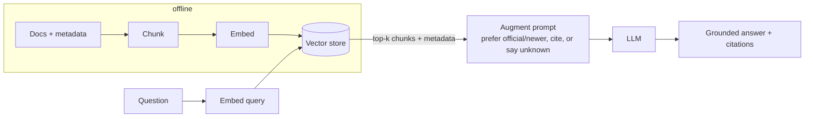

# 14 · Knowledge Retrieval (RAG)

## Summary

Retrieval-Augmented Generation looks up relevant information *before* the model answers. The documents are split into chunks, embedded as vectors, and indexed ahead of time. At query time the question is embedded too, the closest chunks are retrieved by semantic similarity, and they are added to the prompt so the LLM answers from them. The model becomes an open-book reasoner that can use current, private, and specialized knowledge and cite its sources. **Agentic RAG** adds a reasoning layer that judges the retrieved material (freshness, authority, conflicts, gaps) before answering. **GraphRAG** retrieves over a knowledge graph instead of flat chunks.

## Problem and when to use it

An LLM only knows its training data. It doesn't know your HR policy, yesterday's news, or this quarter's budget, and when it doesn't know, it may make something up.

**Use it when**
- Answers must come from a specific corpus: enterprise docs, manuals, FAQs, tickets, legal files.
- Information changes faster than models are retrained.
- Answers must be attributable, with citations.

**Avoid it (or rethink it) when**
- The answer is spread across many documents and relationships. Plain chunk retrieval misses it, so consider GraphRAG or agentic multi-step retrieval.
- The whole corpus fits in context and rarely changes. Long-context prompting may be simpler.
- You can't maintain the index. A stale RAG index produces confidently stale answers.

## Key takeaways

- RAG = **Retrieval** (search the knowledge base) + **Augmentation** (add the hits to the prompt) + generation.
- Core pieces: **embeddings** (meaning as vectors), **semantic similarity/distance**, **chunking**, and **vector databases** (HNSW indexes; FAISS and ScaNN libraries; Pinecone, Weaviate, Chroma, Milvus, Qdrant, pgvector).
- **Hybrid search** = BM25 keyword precision + vector semantic recall. It is usually better than either alone.
- Benefits: fresh and private knowledge, fewer hallucinations, citations.
- **GraphRAG** follows explicit entity relationships, so it can synthesize across documents. It costs more to build and maintain and adds latency.
- **Agentic RAG:** validate sources, reconcile conflicts, decompose multi-part questions, and detect gaps, then use tools such as web search.

## Non-obvious details

- **Chunking strategy shapes answer quality.** Chunk by section or paragraph so a chunk is one coherent idea (the "Troubleshooting" section, not half of it plus half of "Installation"). Bad chunks mean noisy context and a confused LLM.
- **Metadata drives agentic decisions.** The agent can only prefer the 2025 policy over the 2020 blog post, or the final financial report (€65k) over the proposal (€50k), if each chunk carries metadata like date, type, and source. Store it at indexing time.
- **Name the "not found" path.** Tell the model to say "I don't know" when the sources lack the answer. Otherwise it falls back on its training data, and the grounding guarantee quietly disappears.
- **Operational costs:** pre-processing the entire corpus, periodic re-indexing as wikis change, more latency, and more prompt tokens per query.
- **Agentic RAG adds its own failure modes:** extra cost and latency, reasoning loops, and wrongly discarding a relevant chunk.
- **RAG as memory.** Long-term memory services (Ch 8) and learning from past solutions (Ch 9) are RAG over the agent's own history.
- **ADK options:** the `google_search` tool (web grounding), `VertexAiRagMemoryService` (managed corpus with `similarity_top_k` and `vector_distance_threshold`), and Vertex AI Search.



## Worked example

[`rag.py`](rag.py) is a small RAG pipeline with a lightweight agentic layer built into the prompt:

- `KNOWLEDGE_BASE` contains deliberately conflicting documents: a 2020 blog vs the 2025 remote-work policy, and the Alpha proposal vs the final financial report. Each has `source`, `date`, and `kind` metadata.
- `build_retriever()` embeds the documents with `gemini-embedding-001` into LangChain's `InMemoryVectorStore` and returns a top-k retriever. Swap in Chroma, pgvector, and so on for real use.
- `ask()` formats the hits *with their metadata* and uses a prompt that requires source-only answers, conflict resolution (official or final over drafts, newer over older), `[source]` citations, and "I don't know" for the out-of-corpus question.

The documents are short, so each one is a single chunk. For real documents, add a splitter (for example `langchain-text-splitters`). The retrieval wiring was checked offline with a stub embedding.

```bash
pip install -r ../requirements.txt
export GOOGLE_API_KEY=...
python rag.py
```
