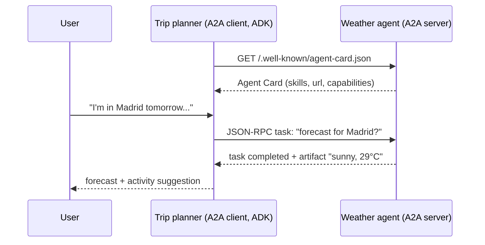

# 15 · Inter-Agent Communication (A2A)

## Summary

A2A (Agent2Agent) is an open, HTTP-based protocol that lets agents built on *different* frameworks and run by different teams (ADK, LangGraph, CrewAI, and others) discover each other and delegate work. Each agent publishes an **Agent Card**: a JSON identity listing its endpoint, skills, input and output modes, capabilities such as streaming or push, and auth requirements. A client agent reads the card, then sends **tasks** over JSON-RPC 2.0. The remote agent stays *opaque*: the client never needs to know how it works inside. MCP (Ch 10) connects an agent to tools and data. A2A connects agents to other agents.

## Problem and when to use it

Multi-agent collaboration inside one framework is straightforward (Ch 7). Across frameworks, services, or companies there is no common language, so every pairing needs custom glue.

**Use it when**
- Agents built with different frameworks or owned by different teams must cooperate.
- You want specialist agents deployed independently (their own service and port) and composed at runtime.
- Agents should discover each other's capabilities dynamically.

**Avoid it when**
- All agents live in one process and one framework. In-process sub-agents or agent tools are simpler and faster.
- The "remote agent" is really a deterministic API. Expose it as a tool (via MCP) instead.

## Key takeaways

- **Actors:** user, A2A client (the agent acting for the user), A2A server (the remote agent behind an HTTP endpoint).
- **Discovery:** a well-known URI, a curated registry (enterprise), or direct configuration. Current ADK serves the card at `/.well-known/agent-card.json`.
- **Unit of work = task.** A task has an ID and a lifecycle (submitted, working, input-required, completed or failed). Content travels as **messages** made of **parts** (text, file, JSON). Outputs are **artifacts**, which can be streamed. A `contextId` groups related tasks across turns.
- **Interaction modes:** synchronous request/response, async polling, streaming via SSE, and push notifications via webhooks for very long tasks.
- **A2A vs MCP:** complementary. MCP is agent-to-tool or agent-to-context. A2A is agent-to-agent coordination and delegation.

## Non-obvious details

- **Opaque by design.** The client only sees the card and the task results, never the remote agent's prompts, tools, or memory. That keeps team boundaries and IP intact, but debugging crosses a network and ownership boundary, so audit logs matter.
- **The `input-required` state** enables multi-turn delegation. The remote agent can pause a task to ask the client for missing information, and context is preserved through the `contextId`.
- **Pick the interaction mode per task length.** Sync for quick answers, polling or SSE for minutes, webhooks for hours, so you don't hold open connections or poll constantly.
- **Security model:** mutual TLS, audit logs of all inter-agent traffic, auth requirements declared in the Agent Card, and credentials (OAuth 2.0 tokens or API keys) sent in HTTP headers, never in URLs or bodies. Protect the card endpoint itself as well.
- **Method names drift between protocol versions.** The book shows `sendTask` / `sendTaskSubscribe` and `tasks/send` / `tasks/sendSubscribe`. Rely on the SDK rather than hand-writing JSON-RPC.
- **In ADK**, `to_a2a(agent)` turns any agent into an ASGI app that serves both the card and the RPC endpoint. `RemoteA2aAgent` is a local proxy you can use as a `sub_agent`. ADK still marks its A2A support as experimental.



## Worked example

Two independent processes talk over A2A:

- [`weather_server.py`](weather_server.py) is an ADK `weather_agent` with a `get_forecast` tool, exposed with `to_a2a(...)` and served by uvicorn on port 8001. Its Agent Card is generated automatically from the agent's name, description, and tools. Fetching the card was checked locally, with no API key needed for that step.
- [`trip_planner_client.py`](trip_planner_client.py) is a separate ADK `trip_planner` whose only sub-agent is a `RemoteA2aAgent` pointing at the server's card URL. The coordinator delegates weather questions over HTTP, then plans an activity from the answer.

```bash
pip install -r ../requirements.txt
export GOOGLE_API_KEY=...
python weather_server.py
curl localhost:8001/.well-known/agent-card.json
python trip_planner_client.py
```

Run `weather_server.py` in one terminal and the client in a second terminal.
