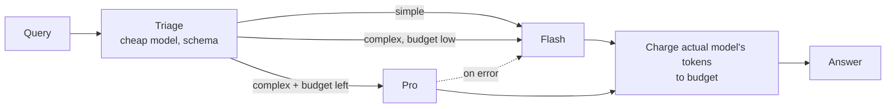

# 16 · Resource-Aware Optimization

## Summary

Resource-aware optimization makes the agent manage its own cost, latency, compute, and energy while it works. The core move is **dynamic model switching**: a cheap router judges how hard each request is and sends easy work to a fast, inexpensive model (Flash) and hard work to a strong, expensive one (Pro). Remaining budget and time also shape the choice, and **fallbacks** keep service running when the preferred model is overloaded. Planning decides *what* to do. This pattern decides *how much to spend* doing it.

## Problem and when to use it

Sending every request to the best model is slow and expensive. Sending everything to the cheapest model fails on hard tasks. A fixed choice can't adapt to mixed traffic, budgets, or deadlines.

**Use it when**
- Traffic mixes trivial and hard requests: support bots, Q&A, assistants.
- Cost or latency caps exist, such as a per-user budget or real-time response targets.
- The system has a plan-then-execute structure. Plan with a strong model, run the repetitive tool calls with a cheap one.
- Reliability matters, so a backup model is needed when the primary is throttled.

**Avoid it when**
- Volume is low and quality is all that matters. Routing adds a call and a misrouting risk for little saving.

## Key takeaways

- The router can use simple heuristics (query length), an LLM classifier, or a fine-tuned router model. Prompt tuning and fine-tuning both improve its decisions.
- **Hierarchical split:** the planner on Pro, the tool-calling workers on Flash. The planning needs intelligence, while the lookups are routine.
- A **critique agent** closes the loop. It catches bad routing in both directions (simple queries sent to Pro waste money, complex queries sent to Flash give poor answers), and that feedback refines the router.
- **Gateways help.** OpenRouter's `openrouter/auto` picks a model per prompt, and its `models: [...]` list gives automatic sequential fallback. The bill and the reported model reflect whichever model actually served the request.
- **Wider toolbox:** adaptive tool selection by cost and latency, contextual pruning and summarization, proactive resource prediction, cost-sensitive multi-agent communication, energy-efficient (edge) deployment, distributed execution, learned allocation policies, and graceful degradation.

## Non-obvious details

- **The router must be cheap.** Classifying with an expensive model defeats the point. Use the smallest model, or rules, for triage.
- **Budget is state.** Track actual spend from each response's token usage, and let the router read the *remaining* budget. Near the limit, downgrade instead of failing.
- **Charge what actually ran.** With fallbacks, the model that served the request may not be the one you asked for. Cost and quality metrics must use the actual model, as OpenRouter's metadata does.
- **Count the overhead.** Triage calls, critique calls, and retries cost tokens too. Leaving them out makes the savings look larger than they are.
- **Three-way routing is common:** simple, reasoning, or needs-fresh-data (web search). The book's OpenAI example routes `internet_search` queries through Google Custom Search before answering.
- **Context is a resource too.** Pruning and summarizing history cuts prompt tokens on every later call, which is often a bigger saving than model switching.



## Worked example

[`budget_router.py`](budget_router.py):

- `triage` classifies each query as `simple` or `complex` with Flash. `include_raw=True` keeps the raw message so its tokens are charged too.
- `choose_model()` is the policy: Pro only for complex queries *and* only while `remaining_usd ≥ STRONG_CALL_RESERVE_USD`. Otherwise Flash.
- Pro is wrapped with `.with_fallbacks([flash])`. `served_model()` reads which model actually answered, and `Budget.charge()` bills that model's real `usage_metadata` tokens.
- The prices in `ILLUSTRATIVE_USD_PER_MILLION_TOKENS` are placeholders. Put current list prices there.

The `assert` lines test the routing policy offline, including the downgrade when the budget is nearly spent.

```bash
pip install -r ../requirements.txt
export GOOGLE_API_KEY=...
python budget_router.py
```
