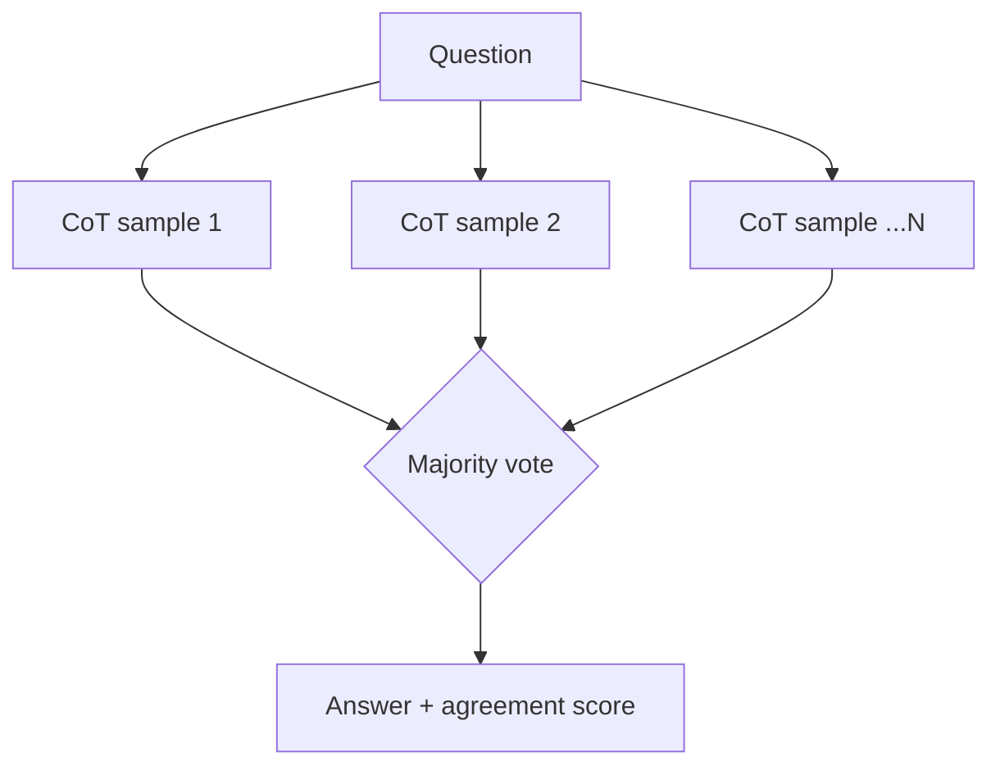

# 17 · Reasoning Techniques

## Summary

This chapter collects techniques that make an agent's reasoning explicit and give it more compute at inference time, so it can decompose problems, explore alternatives, check itself, and use tools before committing to an answer:

- **Chain-of-Thought (CoT)**: reason in written steps.
- **Tree-of-Thought (ToT)**: branch, evaluate, and backtrack.
- **Self-correction**: critique and revise your own draft.
- **Program-Aided LMs (PAL)**: write and run code for exact work.
- **ReAct**: interleave Thought, Action, Observation.
- **Debate frameworks**: Chain of Debates and Graph of Debates.
- **RLVR-trained reasoning models**: long, adaptive "thinking".

The unifying idea is the **Scaling Inference Law**: quality rises with inference-time compute, so a smaller model that thinks more can beat a bigger one that answers in one pass.

## Problem and when to use it

A single-pass answer fails on multi-hop questions, math, debugging, and planning. The model jumps to a plausible but wrong conclusion and leaves no trace of how it got there.

**Use it when**
- The problem needs decomposition, multi-step logic, exact computation, or interaction with tools or data.
- Showing the work matters, for auditing, debugging, or user trust.

**Avoid it when**
- The task is simple recall or formatting. Extra reasoning only adds latency and tokens.
- Latency budgets are tight. Spend thinking compute selectively, and route easy queries elsewhere (Ch 16).

## Key takeaways

- **CoT**: "think step by step" or few-shot reasoning examples. It is more accurate and more transparent.
- **ToT**: keep several partial solutions, score them, expand the best, and backtrack from dead ends.
- **Self-correction**: review the draft against the original requirements, propose specific fixes, then rewrite (see Ch 4).
- **PAL**: offload arithmetic, logic, and data manipulation to deterministic code execution.
- **ReAct**: the core agent loop of Thought, Action, Observation, repeated until a "finish" action. It adapts to real feedback, unlike linear CoT.
- **Debates**: Chain of Debates (Microsoft) has diverse models argue and critique like peer review. Graph of Debates turns arguments into nodes with supports/refutes edges and picks the best-supported cluster.
- **Reasoning models** are trained with **RLVR** (reinforcement learning on problems with verifiable answers). They spend a variable amount of thinking on each problem, scaled to its difficulty.

## Non-obvious details

- **Scaling Inference Law in practice.** Sampling several candidates (self-consistency, diverse beam search) and selecting the best costs more compute, but it lets a cheaper model match a bigger one. It is a deliberate trade between model size, latency, and cost.
- **How often to think in ReAct.** For knowledge-heavy tasks (fact-checking), interleave a thought with every action. For long action sequences (navigating environments), think sparingly and let the agent decide when to reason. Few-shot trajectories guide ReAct behaviour.
- **Deep Research = inference scaling plus ReAct.** You give it a time budget of minutes. It explores, finds gaps and contradictions, runs follow-up searches, and synthesizes. Google's open-source `gemini-fullstack-langgraph-quickstart` is a LangGraph reference with the nodes generate_query, web_research (parallel), reflection, and finalize_answer.
- **MASS (Multi-Agent System Search)** automates multi-agent design in three stages: (1) optimize each agent's prompt alone, (2) search *influential* topologies instead of an unconstrained space, (3) jointly optimize prompts for the final workflow. For coding, the best topology it found was reflection plus an executor that runs tests.
- **CoT is not ground truth.** Written reasoning can be wrong or post-hoc. Verify with code (PAL), tests, or voting rather than trusting a fluent chain.



## Worked example

- [`self_consistency.py`](self_consistency.py) shows inference-time scaling with CoT. It samples `SAMPLES` step-by-step solutions concurrently at temperature 1.0, each as a `Solution` schema with `reasoning_steps` and `final_answer`. `majority()` then picks the most common answer and reports the agreement rate. Low agreement is a useful "not sure" signal. The question is the classic bat-and-ball trap (correct answer 5¢; the tempting wrong answer is 10¢). The `assert` checks the voting offline.
- [`pal_adk.py`](pal_adk.py) shows Program-Aided reasoning with ADK. The agent must write and run Python through `BuiltInCodeExecutor`, which runs in Gemini's sandbox, not on your machine, instead of doing arithmetic itself. `verbose=True` shows the generated code and its output.
- [`react.py`](react.py) is the ReAct loop with a visible Thought: the system prompt forces a `Thought:` line before every tool call, each Action and Observation is printed, and a reply with no tool call ends the loop. The tool loop in [Tool Use](../05-tool-use/README.md) is the same loop without the Thought step. For **self-correction**, see [Reflection](../04-reflection/README.md).

```bash
pip install -r ../requirements.txt
export GOOGLE_API_KEY=...
python self_consistency.py
python pal_adk.py
```
