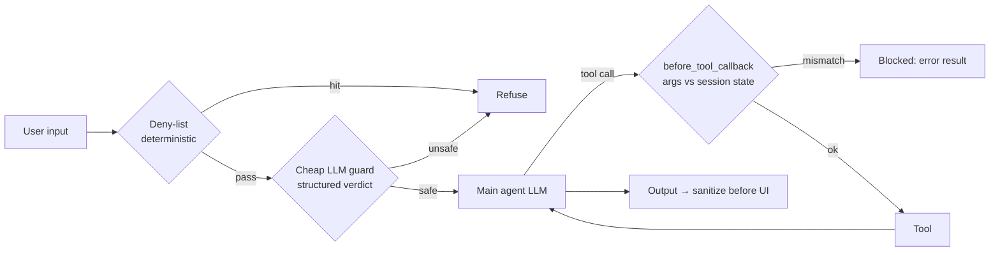

# 18 · Guardrails / Safety Patterns

## Summary

Guardrails are the protective layers around an agent that keep it safe, on-policy, and on-topic. They screen what goes in, constrain what the agent may do, and check what comes out. They sit at several stages: input validation and sanitization, prompt-level behavioural constraints, tool-use restrictions and parameter validation, output filtering, external moderation APIs, and human oversight. A fast, cheap model (Flash or Flash-Lite) often acts as a pre-screener or double-checker for the main model. The aim is not to limit the agent's capability but to make its behaviour predictable, trustworthy, and compliant.

## Problem and when to use it

An autonomous agent driven by user input can be manipulated (jailbreaks, prompt injection), can produce harmful, biased, or off-brand content, can drift off-topic, and can misuse tools, for example by reading another user's data. Without guardrails its behaviour is unconstrained and potentially dangerous.

**Use it** for every agent exposed to users or acting on real systems. Customer service, content generation, tutoring, legal, HR, and research assistants all have domain-specific "must never" rules.

**Calibrate**
- Guardrails that are too strict block legitimate users. The book's screener defaults to "compliant" when unsure for this reason. Pick the default per domain.

## Key takeaways

- **Defense in depth.** No single guardrail is enough. Combine deterministic rules (allow and deny lists, schema validation), an LLM policy screener, tool-level checks, output filtering, and HITL for critical cases.
- **A cheap model as guard:** a fast LLM evaluates inputs or outputs against a written policy and returns a structured verdict (`compliance_status`, `evaluation_summary`, `triggered_policies`).
- **Typical policy categories:** instruction subversion (jailbreaks), prohibited content (hate, violence, explicit material, illegal activity), off-domain topics (politics, academic dishonesty), and proprietary or competitor information.
- **Tool guardrails:** validate tool arguments against trusted session state before running the tool. ADK's `before_tool_callback` can block a call by returning a result.
- **Engineering reliability** applies classic software discipline to agents: checkpoint and rollback (commit/rollback transactions for agent state), modularity, structured logging of the full reasoning and tool trace, and least privilege.
- Guardrails need ongoing monitoring and refinement as attacks and usage change.

## Non-obvious details

- **Validate the guard's own output.** The book's CrewAI example wraps the policy LLM with a Pydantic guardrail function that parses, strips markdown fences, validates the schema, and checks allowed values. A guard that returns malformed output is itself a failure mode.
- **Least privilege limits the blast radius.** A news-summarizing agent gets a news API, not file or system access. If the agent is compromised or confused, it can only damage what it was allowed to touch.
- **Trusted identity comes from state, not from the prompt.** Compare tool arguments with server-side session state (`user_id`). Never trust an identity the model or the user typed.
- **Sanitize rendered output.** Model-generated content shown in a UI can carry script injection. Escape it before display.
- **Platform controls (Vertex AI):** agent and user identity and authorization, built-in Gemini content filters, system instructions, isolated code execution, and network boundaries (VPC Service Controls). Start with a risk assessment specific to the agent's domain and deployment.
- **Callbacks run on every model call.** A `before_model_callback` also fires after tool results come back. Screen only genuine user turns, or you will judge tool output as if the user wrote it.



## Worked example

[`guarded_agent.py`](guarded_agent.py) is an ADK bookstore support agent with three layers:

1. **`screen_input`** (`before_model_callback`). It first applies a deterministic deny-list (`BLOCKED_PATTERNS`), then a Flash-Lite policy check that returns a `Verdict` schema. If either flags the input, it returns a canned `LlmResponse` and the main model never runs. It skips non-text turns such as tool results.
2. **`enforce_own_account`** (`before_tool_callback`). It blocks `get_orders` unless `args["user_id"]` matches the trusted `user_id` in session state. This is the book's tool-parameter validation pattern.
3. **The instruction itself** keeps the agent scoped to bookstore topics. This is the prompt-level constraint.

The demo session sends a normal request, a cross-account request (blocked at the tool), a jailbreak (blocked by the deny-list), and an off-topic question (blocked by the LLM guard). The deterministic layers were tested offline.

```bash
pip install -r ../requirements.txt
export GOOGLE_API_KEY=...
python guarded_agent.py
```
