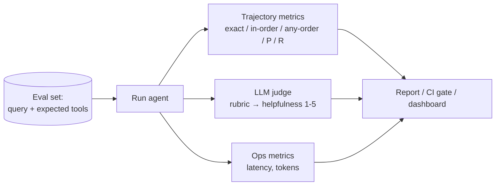

# 19 · Evaluation and Monitoring

## Summary

Evaluation and monitoring is the *external*, continuous measurement of whether an agent is effective, efficient, and compliant, both before release (test files, eval sets) and in production (latency, tokens, quality drift, anomalies). It differs from Goal Monitoring (Ch 11), which is the agent checking its *own* progress. Because agents are probabilistic, you evaluate two things: the **final response** and the **trajectory**, meaning the sequence of tools and steps the agent took to get there. The chapter ends with the "contractor" model: formal, negotiable, verifiable task contracts for high-stakes work.

## Problem and when to use it

Traditional pass/fail tests don't fit non-deterministic agents. Performance drifts as inputs change, tools change, and models get updated. Without measurement you can't compare versions, catch regressions, control cost, or prove compliance.

**Use it**
- During development: unit-style test files and multi-turn eval sets in CI.
- In production: latency, token or cost tracking, quality sampling, drift and anomaly detection.
- For A/B comparisons of agent versions, and for compliance or safety audit reports.

## Key takeaways

- **Response assessment.** Exact match is too strict ("The capital of France is Paris" ≠ "Paris is the capital of France"). Use string similarity (Levenshtein, Jaccard), keyword checks, embedding cosine similarity, LLM-as-a-judge, and RAG metrics (faithfulness, relevance).
- **Operational metrics:** latency and token usage, logged to persistent storage (JSON logs, Prometheus or InfluxDB, BigQuery, Datadog or Grafana), not printed to the console.
- **LLM-as-a-judge:** a rubric with explicit criteria and a structured score. It is consistent and scalable, but limited by the judge model and can miss intermediate steps.
- **Trajectory metrics:** exact match, in-order match (extra steps allowed), any-order match, precision, recall, and single-tool use. High-stakes flows demand exact match; flexible ones use in-order or any-order.
- **ADK evaluation:** *test files* (one session, unit tests) and *evalsets* (many multi-turn sessions, integration tests). Run them via `adk web`, pytest (`AgentEvaluator.evaluate`), or `adk eval`.

## Non-obvious details

- **Methods trade off.** Human evaluation captures subtle behaviour but doesn't scale. LLM-as-a-judge scales but inherits the model's limits. Automated metrics are objective and cheap but capture only part of the capability. Combine all three.
- **Multi-agent evaluation is team evaluation.** Did agents hand off correct data (flight dates passed to the hotel agent)? Did they follow the plan, or get stuck looping on a "perfect" rental car? Was the right agent chosen (live weather agent vs generic knowledge)? Does adding an agent help, or does it add conflict and latency?
- **Environments drift too.** Test cases must evolve with the tools, data, and user behaviour, or the eval suite quietly stops measuring reality.
- **Contractor model** (Gulli et al., "Agent Companion"), four pillars: (1) a formal contract that specifies deliverables, data sources, scope, cost, and time, so results are objectively verifiable; (2) negotiation before execution ("database XYZ is inaccessible, approve an alternative?"); (3) quality-first iterative execution (generate alternatives, run the contract's tests, submit only what passes); (4) hierarchical subcontracts for big jobs.
- **AI "contracts" for enterprise governance** codify objectives, rules, and controls for delegated tasks. They also give evaluation a ground truth to measure against.



## Worked example

- [`trajectory_metrics.py`](trajectory_metrics.py) runs **offline**. It implements the chapter's trajectory comparisons (`exact_match`, `in_order_match`, `any_order_match`, `precision`, `recall`) as small pure functions, with asserts covering the extra-step, wrong-order, and missing-step cases.
- [`evaluate_agent.py`](evaluate_agent.py) is an eval harness for an ADK smart-home agent, the book's "turn off device_2 in the Bedroom" scenario. For each case in `EVAL_SET` it runs the agent in a fresh session and pulls the tool-call trajectory, total tokens, latency, and final reply from the ADK events. It scores the trajectory against `expected_tools` and asks a judge model for a rubric-based helpfulness score as a `Judgement` schema. Each case prints one JSON line, ready to ship to a log store.

```bash
pip install -r ../requirements.txt
python trajectory_metrics.py
export GOOGLE_API_KEY=...
python evaluate_agent.py
```
