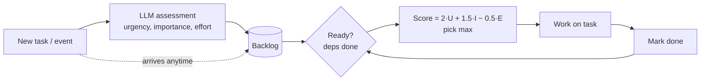

# 20 · Prioritization

## Summary

Prioritization lets an agent rank competing tasks, goals, or actions by explicit criteria (urgency, importance, dependencies, resource availability, cost/benefit, user preference) and work on the most valuable *ready* item first. It re-ranks whenever something new arrives. It works at three levels: picking the overarching goal, ordering sub-tasks within a plan, and choosing the next immediate action.

## Problem and when to use it

Real agents face more demands than they can serve: many tickets, conflicting objectives, limited time and budget. Without a ranking process they work first-in-first-out, get stuck on low-value work, or miss the critical event.

**Use it when**
- Multiple tasks or goals compete for limited resources or time (support queues, project boards, alert triage, cloud scheduling).
- New, possibly urgent events arrive while work is in progress.
- Some tasks are prerequisites for others.

**Avoid it when**
- There is a single task, or a fixed pipeline. Ordering is already decided.

## Key takeaways

- The four components: **criteria definition**, then **task evaluation** against the criteria, then **scheduling/selection logic**, then **dynamic re-prioritization**.
- Typical criteria: urgency (time sensitivity), importance (impact on the goal), dependencies, resource readiness, cost vs benefit, user preferences.
- Evaluation can be simple rules, a scoring formula, or LLM reasoning. A common hybrid: an LLM *rates* each task, deterministic code *ranks* them.
- Safety-critical actions dominate. In autonomous driving, braking beats lane discipline and fuel efficiency.
- Re-prioritization is what separates an agent from a static queue.

## Non-obvious details

- **Let the LLM judge, let code decide.** LLMs are good at reading a messy ticket and estimating its urgency. They are inconsistent at ranking a long list. Have the model output per-task scores in a bounded schema, then apply a fixed, auditable formula.
- **Dependencies gate readiness.** A high-priority task whose prerequisite isn't done can't run. Select only among *ready* tasks, otherwise the scheduler picks work that can't start.
- **Make the weights explicit.** Urgency vs importance vs effort is a policy choice. Named constants make it reviewable and tunable, for example after evaluation (Ch 19).
- **Re-rank on events, not on a timer.** New critical input (an outage report, an approaching deadline) should trigger re-evaluation at once.
- **The book's agent** is a LangChain ReAct project manager with tools to create tasks, set P0/P1/P2, assign workers, and list tasks. It maps words like "urgent" to P0 and applies defaults (P1, Worker A) when information is missing. This is prioritization as instructed tool use.
- **Starvation.** Pure priority ordering can postpone low-priority work forever. Add aging (priority grows with wait time) if everything must eventually run.



## Worked example

[`prioritizer.py`](prioritizer.py):

- `assess()` asks the LLM for a bounded `Assessment` (urgency, importance, effort, each 1–5).
- `Task.priority` applies the explicit weights (`URGENCY_WEIGHT`, `IMPORTANCE_WEIGHT`, `EFFORT_PENALTY`).
- `ranked_ready()` returns the ready tasks (all `depends_on` done), highest priority first. The loop takes the top one.
- The demo works through a backlog. After the schema task finishes, a "production checkout is down" task arrives mid-run and is picked next, ahead of everything already queued. That is dynamic re-prioritization.

The `assert` lines check the dependency-aware selection offline, using fixed assessments.

```bash
pip install -r ../requirements.txt
export GOOGLE_API_KEY=...
python prioritizer.py
```
