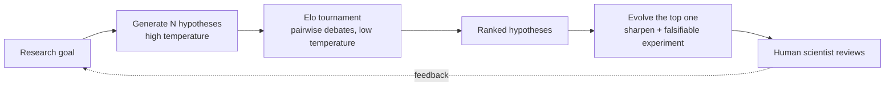

# 21 · Exploration and Discovery

## Summary

Exploration and discovery is about agents that go looking for *new* knowledge. They generate hypotheses, design and run experiments, and surface "unknown unknowns", instead of only optimizing inside a known solution space. The flagship systems are multi-agent setups that imitate the scientific method. **Google's AI Co-Scientist** runs generate, debate, and evolve: generation, reflection, Elo-tournament ranking, evolution, proximity clustering, and meta-review agents under a supervisor. **Agent Laboratory** has professor, postdoc, ML/SW engineer, and reviewer agents that carry a project from literature review to experiments to report, sharing results through AgentRxiv.

## Problem and when to use it

Pre-programmed knowledge and fixed workflows can't produce novel insight. In open-ended domains (science, markets, security, creative work) the solution space isn't defined in advance, so the agent has to expand it.

**Use it when**
- The goal is new hypotheses, strategies, or insights rather than executing a known process.
- The domain is complex or changing fast, and static knowledge is not enough.
- A human expert can stay in the loop to steer and validate ("scientist-in-the-loop").

**Avoid it when**
- The task is well defined. Exploration is expensive, slow, and produces many dead ends by design.

## Key takeaways

- Exploration means proactively setting sub-goals and probing unfamiliar territory. It is the exploration side of the exploration–exploitation trade-off.
- Co-Scientist's loop: **generate** hypotheses (literature plus simulated debates), **reflect** (peer review for correctness and novelty), **rank** (Elo tournament of pairwise debates), **evolve** the leaders, **cluster** similar ideas (proximity graph), and **meta-review** to improve the system itself.
- **Test-time compute scaling** works here too: more compute gives better hypotheses, as measured by Elo. On GPQA diamond it reached 78.4% top-1, and its internal Elo tracked accuracy.
- Real validation: novel AML drug-repurposing candidates (for example KIRA6) confirmed in vitro, liver-fibrosis targets validated in organoids, and an antimicrobial-resistance mechanism found in 2 days that matched an independent lab's decade-long, then-unpublished result.
- Agent Laboratory mirrors an academic hierarchy and uses **three reviewer agents** with different perspectives (experimental rigor, impact, novelty) to approximate human judgment.

## Non-obvious details

- **Pairwise beats absolute scoring.** LLMs are more reliable at "which of these two is better?" than at assigning absolute scores. An Elo tournament turns many pairwise debates into a stable ranking, and the rating doubles as a quality signal.
- **Diversity before selection.** Generate with high temperature, judge at low temperature. The proximity graph exists to avoid exploring near-duplicates.
- **Augment, don't replace.** Both systems keep the human scientist steering through natural language. The AI handles the computationally heavy search.
- **Known limits:** only open-access literature (paywalled prior work is missed), almost no *negative* results (rarely published, yet crucial), and inherited LLM hallucination.
- **Safety gates both ends.** Co-Scientist screens research goals on input and checks generated hypotheses. It rejected dangerous goals in a 1,200-goal adversarial evaluation. Access is limited through a trusted-tester program.
- **Patterns combined.** This chapter combines nearly every earlier pattern: multi-agent (7), reflection (4), prioritization and ranking (20), reasoning and inference scaling (17), tool use and code execution (5), and HITL (13).



## Worked example

[`hypothesis_tournament.py`](hypothesis_tournament.py) is a minimal version of Co-Scientist's generate, rank, and evolve loop:

- `generate()` asks a high-temperature model for `HYPOTHESES` distinct, testable hypotheses as a `Hypotheses` schema.
- `tournament()` runs every pair through `debate()`, a low-temperature "critical peer reviewer" that returns a `Match` (winner A or B, plus a reason), and updates ratings with `elo_update()` (standard Elo with `ELO_K = 32`).
- `evolve()` refines the top-rated hypothesis and adds a falsifying experiment, which is the hand-off point for a human.

The Elo maths and the tournament wiring were tested offline with a stubbed judge.

```bash
pip install -r ../requirements.txt
export GOOGLE_API_KEY=...
python hypothesis_tournament.py
```
