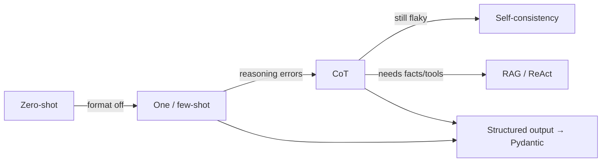

# 22 · Appendix A: Advanced Prompting Techniques

## Summary

Prompting is the interface every pattern in this book runs through. This appendix collects techniques in four groups:

- **Core principles:** clarity, conciseness, action verbs, positive instructions, iteration.
- **Basic techniques:** zero-shot, one-shot, few-shot, many-shot.
- **Structure:** system prompts, roles, delimiters, context engineering, structured output parsed into Pydantic.
- **Reasoning and action:** CoT, self-consistency, step-back, Tree of Thoughts, ReAct.

It also covers ways to *optimize* prompts: automatic prompt engineering (APE), iterative refinement, negative examples, analogies, factored decomposition, and using an LLM to refine prompts.

## Problem and when to use it

The same model gives very different quality depending on how the request is framed. Vague, cluttered, or unstructured prompts produce ambiguous, inconsistent, or unparseable output, and in an agent that error propagates to every later step.

**Use it** everywhere. Every LLM call in an agent is a prompt. Spend the most care on prompts whose output feeds code (routers, extractors, judges).

## Key takeaways

- **Principles:** what confuses a person confuses the model. Use precise action verbs (Extract, Classify, Summarize). Prefer *instructions over constraints*: say what to do, not only what to avoid. Iterate and document your attempts.
- **Zero-shot** first. **One-shot** for an unusual format. **Few-shot** (3–5 examples) for strict formats and classification. **Many-shot** (up to hundreds of examples) now works with long-context models.
- **Structure:** a system prompt for persistent rules, a role for expertise and tone, delimiters (XML tags, ```, ---) to separate instructions, context, and input. **Context engineering** adds retrieved docs, tool outputs, and implicit data such as identity and history.
- **Structured output plus Pydantic:** ask for JSON, then `Model.model_validate_json(...)`. This gives an object-oriented facade and a hard contract at component boundaries ("parse, don't validate").
- **Reasoning:** zero-shot or few-shot CoT. Self-consistency (sample at high temperature, majority vote). Step-back (ask for general principles first, then solve with them as context). ToT (branch and evaluate). ReAct (thought, action, observation).
- **Optimization:** APE (an LLM generates and scores candidate prompts), few-shot example optimization, prompt optimizers (Vertex AI), and the meta approach of asking an LLM to critique your prompt.

## Non-obvious details

- **Mix the classes in few-shot classification examples.** Ordered examples (all positives, then all negatives) let the model latch onto position instead of features.
- **Example quality is everything.** One wrong example confuses the model. Diverse examples that cover edge cases generalize better.
- **CoT best practices:** put the final answer *after* the reasoning, because the reasoning conditions the answer tokens. Use temperature 0 for single-answer problems. Expect more tokens and latency. CoT also makes prompts more robust across model versions.
- **Self-consistency gives a confidence signal** (vote share) at the cost of N times the compute. A refinement is to weight votes by reasoning quality.
- **Negative examples** clarify boundaries, but use them alongside positive instructions, not instead of them.
- **Factored cognition:** decompose a big task into sub-prompts. This is prompt chaining (Ch 1) seen from the prompting side.
- **Engineering hygiene:** use variables in prompt templates, control max tokens, store prompts in the codebase (versioned, separate from logic), and gate changes with automated evaluation (Ch 19).



## Worked example

[`prompting_techniques.py`](prompting_techniques.py) has three techniques side by side:

- `few_shot_sentiment()` uses five examples with **mixed class order**, wrapped in XML **delimiters**. The new review sits in its own `<review>` tag.
- `step_back()` makes two calls: first it asks for the general principles of a good detective story, then it solves the specific task with those principles as delimited context.
- `extract_contact()` and `parse_contact()` request JSON and parse it with `Contact.model_validate_json`. Incomplete output raises `ValidationError` instead of leaking downstream.

The `assert` lines test the Pydantic contract offline, for both valid and incomplete JSON. For CoT plus self-consistency, see [Reasoning Techniques](../17-reasoning-techniques/README.md). For ReAct, see [Tool Use](../05-tool-use/README.md).

```bash
pip install -r ../requirements.txt
export GOOGLE_API_KEY=...
python prompting_techniques.py
```
