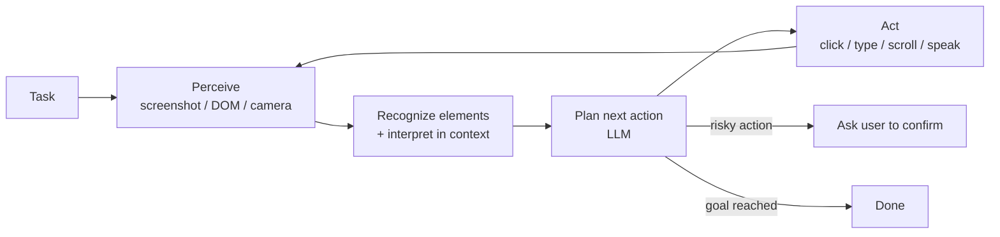

# 23 · Appendix B: AI Agentic Interactions, from GUI to the Real World

## Summary

Agents are moving beyond APIs. They now act through the interfaces humans use. **Agent-Computer Interfaces (ACIs)** let a model operate a graphical UI: it perceives the screen (screenshots or the DOM), recognizes interactive elements, interprets them in the context of the task, and drives mouse and keyboard, watching for feedback after every step. The same perceive, reason, act loop extends to the **physical world** through cameras, microphones, and real-time multimodal models. Examples include ChatGPT Operator and ChatGPT Agent, Google Project Mariner (Chrome), Anthropic Computer Use, the open-source Browser Use library (DOM control), Project Astra, Gemini Live, GPT-4o's Realtime API, and Microsoft Seeing AI.

## Problem and when to use it

Much valuable software has no API, or only a partial one: legacy enterprise apps, arbitrary websites, desktop tools. Building a custom integration for each one doesn't scale, and the physical world has no API at all.

**Use it when**
- A task spans apps or sites that have no usable API (copying spreadsheet data into a CRM, multi-site travel booking, filling long web forms).
- Assistance depends on what the user sees or hears (live camera help, accessibility narration).

**Avoid it when**
- An API, MCP server, or tool exists. Structured calls are faster, cheaper, more reliable, and easier to secure than clicking through a UI.
- The action is high-stakes and the UI changes often. GUI automation is brittle. Pair it with confirmation steps (HITL, Ch 13).

## Key takeaways

- **ACI loop:** visual perception (screenshot), GUI element recognition (a clickable button vs a static banner), contextual interpretation (a magnifier icon means search), then dynamic action with constant re-observation (loading screens, pop-ups, errors).
- **Two ways to perceive the web:** pixels (screenshots, works on any app) or the **DOM** (Browser Use, structured and precise, but browser only).
- **Real-world agents** (Astra, Gemini Live, GPT-4o Realtime) need low-latency, interruptible, multimodal streaming. That is a different engineering budget from text agents.
- **Safety is built in on the products:** ChatGPT Agent requires explicit user authorization for certain action classes and ships a System Card describing misuse vectors.
- **The convergence goal:** one assistant that works across digital and physical environments.

## Non-obvious details

- **Observe after every action.** A GUI agent that clicks and moves on without checking the new screen fails on the first slow load or unexpected modal. Re-perceiving is part of each step, not a separate stage.
- **The ACI module is a translator.** It turns pixels into a structured, labelled layout the LLM can reason about. Better grounding (element IDs, accessibility trees) means fewer misclicks than raw coordinates.
- **The blast radius is the whole desktop.** A computer-use agent can do anything the user can. Run it in a sandbox or VM, apply least privilege, and require confirmation for purchases, sends, and deletes (Ch 18).
- **Prompt injection through the screen.** Web pages and documents the agent *reads* can contain instructions. Treat on-screen text as untrusted data, not as commands.
- **Vibe coding** (also in this appendix): conversational, iterative development that focuses on the *what*, with optional "memory banks" for persistent style and requirements. This idea is continued in [Appendix G](../24-appendix-g-coding-agents/README.md).



## Worked example

No code for this appendix. It surveys products rather than describing a pattern you can reproduce in a few lines. A real GUI agent needs a browser driver or a VM plus a computer-use model, which is beyond a minimal example. The core loop as pseudocode:

```python
def run_gui_agent(task, max_steps=30):
    history = []
    for _ in range(max_steps):
        screen = capture()                      # screenshot or DOM snapshot
        elements = recognize(screen)            # buttons, fields, labels with ids
        action = llm.decide(task, elements, history)
        if action.kind == "done":
            return action.result
        if action.is_irreversible:              # purchase, send, delete
            if not user_confirms(action):
                return "stopped by user"
        execute(action)                         # click(id) / type(id, text) / scroll
        history.append((action, observe_result()))
    return "step budget exhausted"
```

To try one for real: Browser Use (Python, DOM-based) or Anthropic's computer-use reference implementation in a Docker sandbox.
