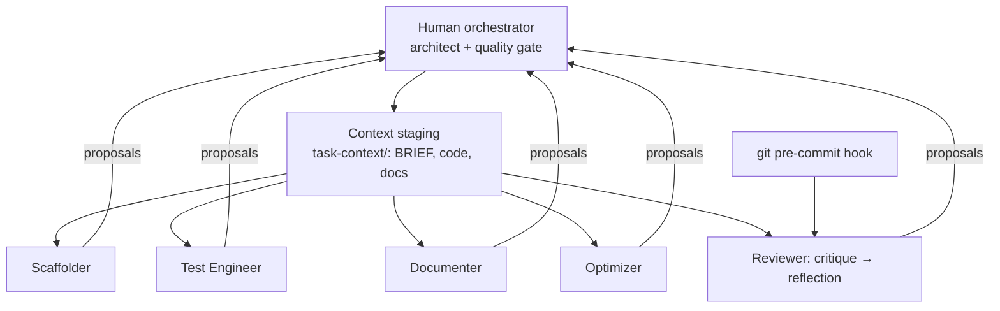

# 24 · Appendix G: Coding Agents

## Summary

"Vibe coding" (conversational, fast generation) is good for ideation and prototypes. Production work needs a structured **human-agent team**. The developer is the **orchestrator**: architect, team lead, and final quality gate. Specialized agent personas handle the tactical work: **Scaffolder** (implements), **Test Engineer**, **Documenter**, **Optimizer** (refactors), and **Process Agent / Reviewer** (critique, then reflection). Every agent is fed from a human-curated **context staging area**. The personas are role prompts on frontier models, not separate apps.

## Problem and when to use it

Ad-hoc prompting of a coding assistant produces code that ignores project patterns, skips tests, and slips past review. More than 30% of new code at Google is AI-assisted, so code quality now depends on *how* developers work with agents.

**Use it when**
- Agents contribute production code in a shared codebase.
- You want repeatable quality steps (tests, docs, review) instead of one-off chats.

**Lighter touch when**
- You are exploring an API or building a throwaway prototype. Vibe coding is the right tool there.

## Key takeaways

- **Three principles:** (1) human-led orchestration, where the developer directs agents and makes final decisions; (2) the primacy of context, where a strong model with poor context is useless; (3) direct access to frontier models, without intermediaries that truncate context.
- **The context staging area** is a per-task `task-context/` folder with the brief (goals, requirements, PR description, style guide), the relevant code, and external docs. It is assembled deliberately by the human, not by black-box retrieval.
- **The Reviewer uses critique then reflection.** First a detailed, static-analysis-style critique, then the agent reflects on its own critique: it dismisses pedantic points, prioritizes, and summarizes into actionable feedback. This is Reflection (Ch 4) applied to review.
- **Setup checklist:** keys for two frontier providers (comparison and redundancy); a local context orchestrator (for example a `context.toml` that lists the files and URLs to include); a **version-controlled prompt library** (`/prompts/*.md`); and **git hooks** (a pre-commit hook runs the reviewer on staged changes).
- **Leadership principles:** keep architectural ownership, master the brief, act as the final quality gate (agent output is a proposal, never a command), and iterate through dialogue.

## Non-obvious details

- **Prompts are code.** Keeping persona prompts in the repo means the team reviews, versions, and improves them together. Prompt changes show up in diffs like any other change.
- **Transparent context beats clever retrieval** for coding. You need to know exactly what the model saw on every request, both to trust the output and to debug bad suggestions.
- **Two providers** let you compare answers on hard problems and keep working through an outage.
- **Hooks make quality automatic.** Running review at pre-commit puts feedback at the cheapest moment to act on it, before the code leaves your machine.
- **Personas focus one model.** "You are a QA engineer… cover all edge cases" and "You are a technical writer…" produce noticeably different, better-targeted work than one generic assistant prompt.



## Worked example

[`review_staged.py`](review_staged.py) is the Process/Reviewer agent as a pre-commit tool:

- `staged_diff()` reads `git diff --cached`. `load_brief()` pulls the human brief from `task-context/BRIEF.md`, which is the context staging area, or falls back to a placeholder.
- The prompts live in the **prompt library** [`prompts/critique.md`](prompts/critique.md) and [`prompts/reflect.md`](prompts/reflect.md), rendered by `render()`.
- `review()` runs the two-step critique, then reflection, and prints at most 5 prioritized, actionable bullets (or "LGTM").

The `assert` lines check prompt rendering and the brief fallback offline. To wire it as a hook, add a `.git/hooks/pre-commit` that calls the script. It prints advice and never blocks the commit. You stay the quality gate.

```bash
pip install -r ../requirements.txt
export GOOGLE_API_KEY=...
git add -p
python path/to/review_staged.py
```

Run the script from your repository root.
